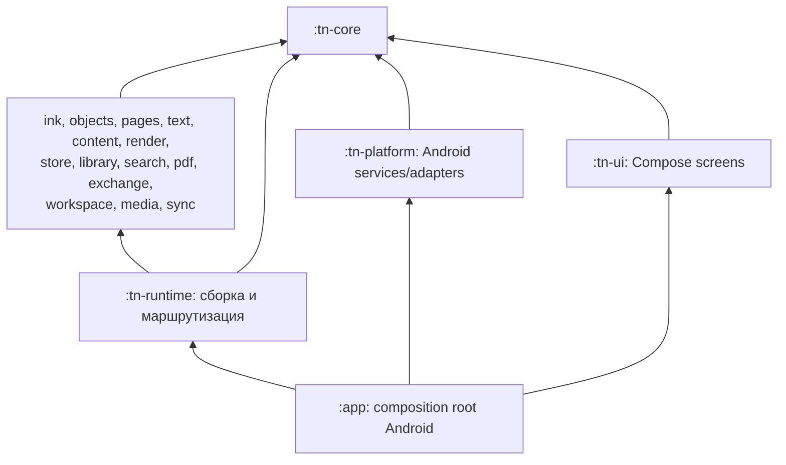

# Truffnotes / Inkspace: архитектура Android-приложения

Дата: 2026-11-05. Статус: проект архитектуры для реализации, а не описание существующего кода.

В каталоге на момент составления есть два исходных документа и `images.zip`; Gradle-модули и Android-проект ещё не созданы. Имя продукта в `truffnotes.md` — Inkspace; технический префикс пакетов ниже — `tn`. Это не требует переименования продукта.

Источники требований: [truffnotes.md](../../truffnotes.md), [goodnotes_red.md](../../goodnotes_red.md). По прямому указанию пользователя при расхождениях приоритет имеет `truffnotes.md`. Только Android. Полный порядок работ: [план](../superpowers/plans/2026-11-05-truffnotes-android.md); границы объёма: [матрица](../plan/requirements.md); правила исполнителя: [контракт](../plan/ai-execution.md).

## 1. Основные решения и их цена

Рекомендуется модульный монолит: одно Android-приложение на Kotlin, Gradle multi-module project, независимые функциональные библиотеки и отдельная сборка зависимостей. «Распределённость» означает разделение ответственности и параллельную разработку; сетевые микросервисы для офлайн-редактора не нужны. Вся собственная прикладная логика — Kotlin.

| Решение | Польза | Ограничение / проверка |
|---|---|---|
| Kotlin + Compose для экранов, Android View/Surface для холста | Один язык и одна модель документа, штатные IME/SAF/lifecycle/accessibility | Compose не пересоздаёт состояние на каждом sample; задержка и GC проверяются F00/F06 |
| Android Canvas/RenderNode с отдельным render executor | Штатный аппаратный pipeline и общий replay drawing commands для экрана/экспорта | SDK скрывает часть GPU allocations; memory caps проверяются также системными измерениями |
| PDFium как готовая Android-зависимость в отдельном процессе | Единый PDF-функционал на API29+, включая text/структуру/annotations | Это нативная библиотека стороннего производителя, не собственный второй движок приложения; проверяются ABI/16KiB/безопасность |

Производительность не следует из выбора языка. Renderer, текстовый pipeline и PDF binding проходят ранний измеряемый gate F00. Если они не проходят, адаптер меняется через ADR, границы модулей и единая модель сохраняются. Два конкурирующих движка документа запрещены.

### Стек

- Kotlin/JVM, Gradle Kotlin DSL, Android Gradle Plugin и Jetpack Compose. Точные совместимые версии JDK/Kotlin/AGP/Compose BOM/SDK и зависимостей фиксирует F00. «Последняя версия» не является воспроизводимой настройкой.
- UI — Compose; холст — SurfaceView/Android View interop, Canvas/RenderNode, hardware rendering. Базовый Surface pipeline работает с API29. Jetpack Graphics low-latency допускается как проверенная оптимизация presentation внутри того же renderer, без второго brush/document pipeline. Собственный Vulkan/OpenGL renderer не разрабатывается.
- Coroutines со structured concurrency: bounded Channel, application-owned scopes, отдельные single-thread executors для engine/render/store/PDF и ограниченный CPU pool. `GlobalScope`, неограниченные launch/queues и отдельный coroutine runtime на каждый модуль запрещены.
- SQLite через `androidx.sqlite` и `BundledSQLiteDriver`: одна закреплённая реализация SQLite/FTS5 на всех версиях Android. `WAL`, `foreign_keys=ON`, `synchronous=FULL` для авторитетных данных; store проверяет фактические PRAGMA и поддержанные функции. Второй ORM/Room поверх того же документа не добавляется без необходимости. Search DB производная.
- `kotlinx.serialization`/CBOR для одного versioned record codec; persistent collections для directory/metadata, primitive arrays/chunks для горячих samples. По объекту на каждую точку пера не выделяется.
- Текст: Android `StaticLayout`/`MeasuredText` и системный shaping. `tn-text` единолично строит layout/selection и platform-neutral TextPaintPlan с line/range/context/bidi/font/position; `tn-render` проигрывает его на Canvas. Для PDF overlay используется тот же replay на `PdfDocument` canvas, затем PDFium объединяет overlay с исходными PDF pages и записывает links/annotations. Нет второго line breaker/shaper в экспорте. F00 проверяет кириллицу/RTL/CJK/emoji и реальную векторность PDF output на API29.
- PDFium — готовая Kotlin/Java-совместимая Android AAR-зависимость с закреплёнными native binaries/checksums, без JavaScript/XFA; отдельный service process и **один поток всех PDFium calls**. Binding должен закрывать render/text/links/outline/page operations/PDF writing, а не только просмотр. Скрытые системные native libraries не используются; собственный native bridge приложения не создаётся.
- Собственная сборка NDK не нужна; ABI и 4/16KiB page-size compatibility обязательны для всех bundled `.so` зависимостей, включая SQLite/PDFium. Production ABI arm64-v8a, тестовый x86_64.

## 2. Допустимый граф зависимостей



Все функциональные Gradle-модули знают **только `:tn-core`** из внутренних production-пакетов. `:tn-runtime` — единственное место импорта и связывания реализаций функций. `:tn-platform` реализует системные порты SAF/input/IME/audio/Surface/IPC, зависит только от core и Android SDK/внешних библиотек. `:tn-ui` зависит от core и UI-библиотек, получает core AppGateway/settings/capabilities через constructor. `:app` соединяет runtime, platform и UI; бизнес-алгоритмы в app не допускаются.

Уровни не образуют второй service locator: runtime получает явный `PlatformPorts`, UI — явный `AppGateway`. PDF service запускает узкую PDF-конфигурацию runtime через app bootstrap, без write-доступа к библиотеке документов.

Ограничение действует на `api`, `implementation`, `compileOnly`, `runtimeOnly`, test/androidTest, build variants, composite builds и reflection/class-name lookup. Общие fixtures — файлы; `:tn-test-support` зависит только от core и разрешён как test dependency. Core тестируется собственными fixtures, без обратной зависимости на support. Реальные cross-module integration tests — в runtime/app.

`:tn-core` — Kotlin/JVM library без Android SDK, SQLite, Canvas, PDFium, Compose и сетевого стека. Нельзя переносить в него renderer/SQL/shape recognition ради обхода графа. Новый контракт вводится вместе с consumer и contract test. Pure algorithms (ink/objects/pages/workspace/exchange), core и test-support — JVM-модули. Render/text/content/store/library/search/pdf/media/sync/runtime/platform/ui — Android library modules там, где нужен Android API/driver; runtime обязан быть Android library, поскольку связывает Android AAR implementations. App — Android application; публичные model/port types у всех из core.

Проверка `architectureCheck` анализирует resolved Gradle project dependencies всех variants/configurations, включая build tooling edges и test-only исключения. `apiCheck` использует зафиксированную Kotlin public API dump. Собственные Detekt rules запрещают sibling imports, mutation из feature/UI и утечку mutable collections/arrays наружу.

## 3. Файловая структура

Целевая структура; каталог создаётся только owning phase. Корневой Gradle project, wrapper и команды — единые, без вложенного второго Android project.

```text
settings.gradle.kts                   # include и разрешённые module edges
build.gradle.kts                      # общие checks и lifecycle tasks
gradle/libs.versions.toml             # единые versions
gradle/dependency-locks/              # reproducible resolution
gradle/verification-metadata.xml      # checksum verification
gradle/wrapper/
gradlew
build-logic/                          # convention plugins / architectureCheck / apiCheck
app/src/main/                        # Application, navigation, composition, manifests
modules/
  tn-core/src/main/kotlin/inkspace/core/
    ids/Ids.kt
    geometry/{Coordinates,Transform,VectorPath}.kt
    model/{Document,Space,Page,Layer,SceneObject,Stroke,RichText,Asset,Link}.kt
    edit/{EditIntent,Mutation,EditPlan,Validation,Apply,Inverse}.kt
    codec/{Records,WriteSet}.kt
    contracts/{Input,Scene,Storage,Pdf,Text,Resources,Jobs,Library,Media,Sync,AppGateway}.kt
    Limits.kt
    Errors.kt
  tn-ink/src/main/kotlin/inkspace/ink/{InkEngine,InputSession,Smoothing,Brush,Geometry,Gesture}.kt
  tn-objects/src/main/kotlin/inkspace/objects/{Selection,HitTest,Erase,Transform,Group,Shape,Snap}.kt
  tn-pages/src/main/kotlin/inkspace/pages/{PagePlanner,Template,Layer,Outline,Frame}.kt
  tn-text/src/main/kotlin/inkspace/text/{TextPlanner,Layout,Ime,Selection,Font}.kt
  tn-content/src/main/kotlin/inkspace/content/{ContentPlanner,Image,Crop,Element,Sticky,Tape,Clipboard}.kt
  tn-render/src/main/kotlin/inkspace/render/{Scene,Renderer,CanvasReplay,Cache,Tiles,Overlay,Surface}.kt
  tn-store/src/main/kotlin/inkspace/store/{Writer,Reader,Schema,Migrate,Journal,Assets,Versions,Gc}.kt
    src/main/resources/migrations/0001_document.sql
  tn-library/src/main/kotlin/inkspace/library/{Catalog,Folders,Tags,Collections,Trash,Operations}.kt
    src/main/resources/migrations/0001_catalog.sql
  tn-search/src/main/kotlin/inkspace/search/{Index,Extract,Query,Overlay,Worker}.kt
    src/main/resources/migrations/0001_search.sql
  tn-pdf/src/main/kotlin/inkspace/pdf/{Session,Render,Text,Links,Structure,Export,BindingAdapter}.kt
  tn-exchange/src/main/kotlin/inkspace/exchange/{Inknote,Manifest,Import,Export,Backup,Stream}.kt
  tn-workspace/src/main/kotlin/inkspace/workspace/{Workspace,Viewport,Tabs,Split,Zoom,Commands,Settings}.kt
  tn-media/src/main/kotlin/inkspace/media/{Audio,Replay,Laser,Timer,Presentation}.kt
  tn-sync/src/main/kotlin/inkspace/sync/{Manifest,Publish,Conflict,Reconcile}.kt  # F21
  tn-runtime/src/main/kotlin/inkspace/runtime/{Runtime,Engine,Dispatch,Services,Scheduler,Residency,Shutdown}.kt
  tn-platform/src/main/kotlin/inkspace/platform/{InputTransport,SessionHandle,SurfaceHost,StorageAccess,ImeHost,PdfService,AudioHost}.kt
  tn-ui/src/main/kotlin/inkspace/ui/{library,notebook,canvas,common,settings}/
  tn-test-support/src/main/kotlin/inkspace/testsupport/{Documents,FakePorts,TestClock}.kt
benchmark/                            # Macrobenchmark / instrumentation / Perfetto
fixtures/{documents,input,pdf,images,corrupt,workloads}/
quality/                              # JVM property/stress/fuzz harnesses и Gradle tasks
tools/spikes/android/                # F00, изолирован от production modules
docs/{architecture,adr,contracts,plan,perf,evidence}/
.github/workflows/{checks,android,nightly}.yml
```

В каждом модуле свой `build.gradle.kts`; unit tests в `src/test/kotlin`, device tests в `src/androidTest/kotlin`. Android resources/manifests — только в Android-модулях; общий core не получает Android dependency ради теста.

Каждый модуль содержит README: ответственность, API, owner состояния, budgets и commands. 500 строк — сигнал review; деление только по смыслу, без `Part1.kt` и универсального `Utils.kt`.

## 4. Владельцы ответственности

| Модуль | Единственный владелец | Вход → выход |
|---|---|---|
| `tn-core` | Types/units/IDs/codec, атомарные validate/apply/inverse | EditPlan → revision/ChangeSet/inverse |
| `tn-ink` | Samples/smoothing/pressure и каноническая vector geometry всех кистей, gesture proposals | InputBatch → draft/EditPlan; GeometryPort |
| `tn-objects` | Hit test/lasso/erase/transforms/groups/shapes/connectors/snap | ObjectAction + read view/geometry port → plan |
| `tn-pages` | Pages/layers/templates/outline/bookmarks/frames | PageAction → plan |
| `tn-text` | Rich text/IME/Unicode mapping, единый Android text layout и TextPaintPlan | TextAction → plan; TextPort → layout |
| `tn-content` | Images/crop/elements/sticky/tape/clipboard bundles | ContentAction + ports → plan/ObjectBundle |
| `tn-render` | CanvasReplay/RenderNode/Surface, raster/vector-PDF overlay и графические caches | immutable scene/artifacts → frame/snapshot/PDF overlay |
| `tn-store` | Document DB/durable log/assets/versions/GC | StorageRequest → durable reply/read lease |
| `tn-library` | Catalog/folders/tags/collections/trash/file-op state machine | LibraryAction → catalog operation/typed effects |
| `tn-search` | Производный FTS/index/ranking/dirty overlay | IndexFacts/SearchRequest → bounded page |
| `tn-pdf` | Все native PDF handles через готовый binding, PDF composition/text/structure/annotations | PdfRequest → reply/artifact |
| `tn-exchange` | Portable container/import/export/backup manifests | ExportSource + core ports → portable output |
| `tn-workspace` | Viewports/tabs/split/zoom/interface modes/commands/settings | ViewAction → ViewState/edit intent |
| `tn-media` | Audio clock/replay/laser/timer/presentation | Media events → ephemeral overlays/metadata plan |
| `tn-sync` | Versioned file publication/conflict/reconcile | manifests → publish/conflict requests |
| `tn-runtime` | Сборка функций, engine actor, scheduler/memory admission | concrete services → AppGateway |
| `tn-platform` | MotionEvent/SAF/IME/Surface/audio/IPC lifecycle | Android callback/port request → typed core message |
| `tn-ui` / `app` | UI/composition и Android entry points | AppGateway → пользовательский flow |

Общая координатная математика — core; brush geometry — только ink; layout — только text; shape recognition/hit testing — objects; ZIP codec — exchange; CanvasReplay — render. Экран/Zoom/PDF используют эти же результаты через core ports. PDF модуль не форматирует текст и не строит strokes заново.

## 5. Модель данных и координат

### Документ

- `DocumentId`, `SpaceId`, `PageId`, `LayerId`, `ObjectId`, `AssetId`, `VersionId` — разные value wrapper, стабильные 128-bit значения; ID никогда не переиспользуется. Asset ID — digest содержимого. Локальный arena index не сохраняется и не передаётся как стабильный ID.
- `DocumentKind.Notebook/Canvas` описывает семантику документа. `InterfaceMode.Notebook/CanvasStudio` — представление. `ViewState` хранится отдельно, режим не конвертирует документ.
- `Space` — общее координатное пространство. Notebook имеет упорядоченные Page/Space; Canvas — свободные Space/Boards и Frame-регионы. Frame хранит прямоугольник/имя/фон/порядок экспорта, **не копирует** попавшие в него объекты. Один объект может пересекать несколько frames.
- У объекта ровно один Space и Layer, affine transform, stable ordering key, visibility/lock/style и typed payload. Группа — ациклическое дерево ссылок внутри Space; не может владеть объектом второй раз. Межпространственный перенос — транзакция с remap IDs и координат.
- PDF — immutable `AssetId` + индекс исходной страницы + crop/rotation transform. Страница документа имеет собственный `PageId`, не равный номеру PDF. Аннотации являются обычными объектами поверх подложки.
- Payload types: Stroke, Shape, Connector, Text, Image, Group, Sticky, Tape, LinkAnchor. Attachments имеют явную связь с parent; скрытие Sticky не удаляет дочерние штрихи. Laser/selection/hover/prediction не входят в document payload.
- Textbox и full-page typing используют один rich-text payload. У full-page контейнер привязан к странице; автоперехода текста на следующий лист нет. Это не отдельный блочный Text Document.

### Точность

- Document units: points, `1 pt = 1/72 inch`. `DocPoint/DocRect` — конечные `Double`; `ViewPx` — физические pixels; Compose layout — dp. Нельзя передавать между ними bare `Pair<Float, Float>` без типа.
- Camera transform и его обратное преобразование определены один раз в core; все input/Zoom/split/PDF используют их. Рендер вычисляет camera-relative координаты и только затем переводит в `Float`.
- Сэмпл штриха хранит локальные `Float x/y` относительно `Double` origin чанка, время delta и нормализованные axes; исходная последовательность реальных samples сохраняется. Новый origin начинается при выходе локальных координат за ±8192pt, чтобы большой world offset не снижал точность samples. Цель encoded sample ≤32 bytes. Primitive arrays/chunks имеют закрытый mutable backing; `FloatArray` не выдаётся читателю как изменяемая ссылка. Persisted layout определяется codec, а не JVM object layout.
- Supported numerical envelope: `abs(world coordinate) ≤ 1e9 pt`, camera scale `1e-4..1e4`; это инженерные ограничения «бесконечного» холста. Выход даёт явную ошибку/ограничение viewport, не NaN и не порчу данных.
- Smoothing/pressure curve version фиксируется у штриха. Старый штрих не меняет форму после обновления алгоритма. Квантизация хранения допустима только с round-trip error ≤0.01 pt; текущие edit coordinates не округляются на каждом движении.

### Память документа

`DocumentSnapshot` — заголовок и persistent/chunked directory, ссылающийся на immutable chunks; persistent snapshot не означает клонирование всего документа. Geometry payload грузится по страницам/областям, а не для всех 1000 страниц.

Read view различает `Present`, `NotResident`, `Missing`: незагруженный объект нельзя принять за удалённый. Планирование над NotResident сначала запрашивает `ReadLease` с byte budget; только после этого строит plan. SQL/R-tree хранит bounds незагруженных объектов; точная геометрия запрашивается для кандидатов. Нет полного scan геометрии на каждый кадр/движение ластика.

Undo хранит inverse deltas/ссылки на immutable blobs, не полные снимки. Совокупные resident chunks, snapshot pins, history pins и export pins входят в общий budget; strong references/GC не освобождают от учёта памяти. Исторические snapshots, renderer и jobs не держат бесконечную цепочку revisions.

## 6. Контракты ядра и единый путь изменений

Ниже — обязательные имена/смысл начального API. Полные Kotlin definitions и contract fixtures фиксируются F01 до независимой разработки модулей. Типы из последующих capabilities добавляются в ядро до старта их фазы, без пустых реализаций.

```kotlin
data class DocVersion(val document: DocumentId, val revision: Revision)
data class SessionKey(val document: DocumentId, val epoch: SessionEpoch)
data class JobStamp(
    val session: SessionKey,
    val resource: ResourceKey,
    val contentVersion: ContentVersion,
    val generation: RequestGeneration,
)

data class EditPlan(
    val base: DocVersion,
    val preconditions: ImmutableList<Precondition>,
    val mutations: ImmutableList<Mutation>,
    val gesture: GestureId,
    val label: UndoLabel,
)

// Outcome<T, E> — core sealed success/error; cancellation не проглатывается.
fun validatePlan(document: DocumentRead, plan: EditPlan, limits: Limits): Outcome<ValidatedPlan, EditError>
fun applyPlan(document: DocumentState, plan: ValidatedPlan): Outcome<AppliedEdit, EditError>
// ValidatedPlan создаёт только core; apply повторно сверяет base/read preconditions.
// Mutable DocumentState никогда не передаётся feature; только отдельный ReadView.

interface GeometryPort {
    fun paths(request: GeometryRequest): Outcome<PathArtifact, GeometryError>
}
interface TextPort {
    fun layout(request: TextLayoutRequest): Outcome<TextLayout, TextError>
}
interface ResourcePort {
    fun read(request: ResourceRequest): Outcome<ResourceLease, ResourceError>
}
interface StoragePort {
    fun trySubmit(request: StorageRequest): Outcome<RequestId, SubmitError>
}
interface PdfPort {
    fun trySubmit(request: PdfRequest): Outcome<RequestId, SubmitError>
}
interface RenderPort {
    fun trySubmit(job: RenderJob): Outcome<RequestId, SubmitError>
}
interface JobSink {
    fun trySubmit(job: JobSpec): Outcome<JobId, SubmitError>
}
```

Thread safety запросов к port обеспечивается его bounded queue/синхронизацией; Kotlin interface сам этого не гарантирует. PDF handles/Canvas/text layout buffers не вызываются из произвольного dispatcher. Geometry/Text тяжёлые методы вызываются worker-задачами, не UI. `RenderJob` — sealed hierarchy `Draw`, `Snapshot`, `PdfOverlay`; все используют один CanvasReplay без shared mutable Paint/Path. Screen Draw идёт на render executor, тяжёлый export — на bounded export executor со своим target/ресурсами, не блокируя кадры. Snapshot/PdfOverlay фиксируют revision/region/units/limits; PdfDocument создаётся на одну overlay page и закрывается после передачи PDF writer, не копит 1000 страниц в одном объекте; PDFium получает готовый overlay, не импортирует renderer.

`DocumentRead` предоставляет `version`, `object(ObjectId)`, `query(SpatialQuery, PageCursor, Limit)`, `page(PageId)`; результаты bounded с residency. Feature получает отдельный read-view, который нельзя привести к mutable DocumentState. Background job получает immutable ReadLease; backing коллекции/массивы не меняются после publication.

Действия — sealed core types `InkAction`, `ObjectAction`, `PageAction`, `TextAction`, `ContentAction`, `LibraryAction`, `ViewAction`, `MediaAction`. Planners: `fun plan(read: DocumentRead, action: XAction, ctx: PlanContext): Outcome<EditPlan, FeatureError>`. Для ввода `InkEngine.ingest(batch: InputBatch, ctx: InputContext): Outcome<InkOutput, InputError>` даёт draft/gesture proposal/готовый plan, не пишет на диск.

`Mutation` содержит явные операции создания/удаления/замены payload, style/transform/order, страниц/слоёв/связей. Core атомарно проверяет locks, parent graph, references, units, base revision и лимиты; mutable поля модели закрыты. Изменения не могут выполняться «для ускорения» напрямую из feature/UI.

`ChangeSet` перечисляет изменённые entity IDs, версии payload, old/new bounds и affected text ranges. Renderer, spatial directory, index и replay реагируют на один ChangeSet; каждый не вычисляет diff всего документа.

### Последовательность редактирования

1. Android копирует реальные historical/current samples в pooled transport buffer и передаёт один batch. `MotionEvent` не сохраняется после callback.
2. Ink формирует временный draft; renderer показывает его по тому же GeometryPort, что и завершённый штрих. Prediction живёт отдельным overlay, не участвует в распознавании/сохранении/undo.
3. Engine actor получает intent, planner строит EditPlan. Core валидирует и применяет его **один раз**; создаёт revision, inverse и write-set.
4. Runtime публикует immutable optimistic snapshot и ставит write-set в FIFO store. UI видит `Saving`, пока нет durable ack. Очередь нельзя переполнить молча.
5. Store сохраняет assets и DB transaction, затем возвращает `DurableAck { document, revision, transaction_id }`. Runtime продвигает durable watermark только непрерывным префиксом revisions.
6. Undo/Redo — новые планы через тот же pipeline. Undo удалённого слоя, shape gesture и cross-page move не имеют обходных веток.

`Applied` и `Durable` — разные статусы. При внезапном kill гарантированно восстанавливаются все durable revisions; незавершённый draft и ещё не подтверждённый хвост могут потеряться. Обещать сохранение ещё не записанных в накопитель байтов нельзя. Требование F03/F23: ноль потерь **подтверждённых** revisions; target durable lag p95 ≤200 ms при штатном storage. Сохранение инициируется на каждом завершении жеста, debounce не откладывает его до ухода приложения в фон.

При ошибке записи unsaved edits остаются pinned и видимы; UI сообщает ошибку, доступен явный recovery export. При достижении pending budget новые изменения временно запрещаются, навигация/копирование доступны. Нельзя очистить pending, показать `Saved` или автоматически откатить цепочку зависимых правок.

Обычный `ExportLease` фиксирует durable revision. Отдельный `RecoveryLease` фиксирует **applied** revision, durable base, неизменяемый ordered pending write-set и все используемые assets, включая staging/pool leases. `ExportSource.Durable(ExportLease)` / `ExportSource.Recovery(RecoveryLease)` предоставляет единый `SnapshotReader`: pending overlays имеют приоритет перед durable base. Source freeze выполняет engine; worker не читает mutable state. Один portable encoder сериализует итоговый snapshot без второго apply/reducer. Recovery manifest содержит `recovered_from_pending`, base/applied revisions и operation IDs; импорт по умолчанию создаёт recovery copy, не затирает старый документ. Успешный recovery export не означает, что исходная библиотека снова сохранена.

Native export потоковый и не требует временной SQLite-копии во внутреннем хранилище: поэтому ENOSPC library volume не мешает recovery при доступном новом SAF output на другом носителе/provider. Если и output недоступен, ошибка остаётся видимой, pending память не освобождается. Это не гарантия пережить kill процесса до записи recovery файла.

## 7. Конкурентность, память, lifecycle

| Исполнитель | Единственное mutable состояние | Запрещено |
|---|---|---|
| Android Main | Compose view state, доступ к View/IME | SQL, fsync, PDF, layout всего документа, ожидание workers |
| Engine actor (1 поток на приложение) | Все открытые document states, истории, drafts и transaction order | Блокирующий I/O; передавать mutable DocumentState/collections другим исполнителям |
| Render executor (1 поток) | Surface/RenderNode/bitmap/frame state | Использовать уничтоженный Surface; менять документ |
| Store writer (1 поток; read jobs отдельно) | SQLite write connections и asset commit order | Клонить connection в общий mutex; писать из UI |
| Bounded CPU pool, 1–4 threads | Локальные job buffers/immutable inputs | Создавать thread на page, object или feature |
| PDF service executor (1 поток процесса) | Все PDFium handles и callbacks | Любые параллельные PDFium вызовы, в том числе экспорт |
| Android audio executor | Recorder/player resources, монотонный media clock | Делать media callback владельцем документа |

Engine actor обслуживает документы короткими квантами; large operation планируется на worker, результаты применяются порциями или одной подготовленной транзакцией. Не допускать starvation активного пера большой операцией другого документа.

### Протоколы очередей

Начальные hard limits; изменение — только вместе с evidence и изменением `Limits`/тестов.

| Канал | Граница | При переполнении |
|---|---|---|
| Samples Main → Engine | 4 MiB pooled batches, batch ≤64 KiB | Сначала drain/coalesce только без потери реальных samples. Если admission невозможен — явный cancel draft/сообщение; нельзя сохранять незаметно испорченную линию |
| Terminal input/control | 64 reserved slots; UP/CANCEL упорядочены sequence number | Reserved cancel path и остановка новых drafts, никогда не `drop newest` |
| Edit/persist FIFO | 256 envelopes, ≤8 MiB resident bytes | Backpressure до приёма новой правки, UI не блокируется |
| DurableAck Store → Engine | 256 slots /256KiB, место резервируется вместе с commit request | При отсутствии reservation новая запись не принимается; ack не отбрасывается и не coalesce-ится как render |
| View/render snapshot | latest mailbox, max 2 retained snapshots | Старый pending snapshot заменяется; committed model не теряется |
| PDF/decode jobs | ≤8 queued / ≤2 expensive active globally | Дальние tiles отменяются в пользу видимых |
| Search | 1 active + 1 latest pending query; page ≤100 results | Последний query заменяет предыдущий, durable jobs здесь не проходят |
| Events service → Main | ≤256 envelopes, ≤2 MiB | Metadata coalescing по версии; ошибки — отдельный канал64 slots/128KiB + operation status в engine до подтверждённого чтения Main; durable acks идут в Engine |

Ограничение элементов дополняется ограничением resident байтов, включая ссылки на pinned RAM blobs; disk asset lease учитывается в disk/pin quota, а не как загруженный файл в RAM. Все resident channel reservations входят в общий cap16MiB: суммы индивидуальных maxima не означают их одновременную выдачу. Terminal события не обгоняют свою последовательность samples. Draft имеет resident window≤8MiB/262144 samples; старые chunks потоково уходят через store в provisional staging и затем могут evict-иться из RAM. Одного разбиения массива на несколько списков со strong references недостаточно: общий resident window остаётся ограничен. До UP эти chunks не являются committed document objects; UP атомарно публикует их ссылки одной logical operation, CANCEL снимает pins и оставляет chunks только для GC. При невозможности spool/pin reservation — явный cancel draft с ошибкой вместо неограниченной памяти. Время внутри события монотонно; gaps и повторный pointer ID отмечаются sequence/epoch.

### Защита от логических гонок

- Каждое открытие документа получает новый `SessionEpoch`; закрытая сессия никогда не принимает старую job reply, даже если `DocumentId` совпал.
- Search использует `(session, query generation, index generation, overlay generation)`; stale result не перезаписывает актуальный список.
- Raster/geometry/text artifacts привязаны к entity content version, brush version, font digest, scale bucket. Unrelated document edit не требует выкинуть правильный tile; наоборот, одного совпадения DocId недостаточно.
- GPU surface имеет `SurfaceEpoch`, resize — generation. Destroy помечает epoch закрытым, renderer завершает/отменяет очередь на своём потоке, освобождает Surface/RenderNode resources после завершения операций renderer. Surface recreate не пересоздаёт документ.
- CANCEL/FLAG_CANCELED отменяет draft соответствующего pointer; ACTION_CANCEL прекращает весь текущий touch stream. Реальное поведение проверяется multi-pointer fixtures на API 29/33+. Системная отмена не является пользовательским Undo другого завершённого штриха.
- Два окна/два viewport одного документа используют **одну engine session**. Read-only/lock проверяются перед core apply, а не только скрывают кнопку. Второй процесс не открывает документ на запись.
- Экспорт получает зафиксированный `ExportLease` revision; не смешивает страницы разных revisions. Его asset pins учитываются admission controller.
- Durable ack не отбрасывается по правилам stale search/render: закрытие сессии ждёт/передаёт владельцу pending persistence, иначе saved watermark станет ложным.
- При отмене task освобождаются leases, file descriptors, bitmap/render targets и reservations. Cancellation не заменяет проверку версии при завершении.

### Правила памяти, корутин и native dependencies

Kotlin/JVM не запрещает data races на уровне типов. Все document states живут только в engine actor; код изменений проверяет owner/executor guard в debug/tests. Каждый request обрабатывается целиком до следующего message. Внутри apply нет suspension points; actor не ждёт disk/PDF/CPU job через `await` или `withContext`, а принимает результат новым stamped message. Single-thread dispatcher без такого actor loop недостаточен: корутины могут логически чередоваться в точках suspension.

Snapshots используют persistent immutable collections; `val List`/`@Immutable`/`asReadOnlyBuffer()` сами по себе не замораживают backing data. `MutableList`, `MutableMap`, Array/ByteArray/FloatArray/ByteBuffer не выдаются наружу без копии или проверяемого owner lease. Hot path: private primitive sample chunks, freeze/handoff один раз на batch, scalar/bounded-copy reads; никаких boxed Point на каждую точку. После передачи pooled batch sender не может менять/recycle его до release. Tests `mutate_after_handoff`, `pool_reuse_after_cancel`, `snapshot_alias` проверяют эти ограничения.

Engine/render/store/PDF имеют application-owned single-thread executors с explicit close; на Default/IO dispatcher их mutable state не переносится. CPU pool ограничен. Mutex допустим для короткого metadata/pool gate, не для общего документа и не вокруг suspension/I/O. `@Volatile` не заменяет атомарность compound операции. `GlobalScope`, `runBlocking` на Main/engine, `Channel.UNLIMITED` и неограниченные async/launch запрещены. CancellationException распространяется; `finally` освобождает leases/reservations, но не отменяет уже durable transaction.

Ресурсы Android имеют closeable generation handles. Surface/Canvas/RenderNode и mutable Paint/Path/Bitmap принадлежат renderer; нельзя recycle/reuse опубликованный bitmap пока render/IPC его читает. MotionEvent копируется в callback и дальше не хранится. Длинные jobs не держат Activity/View. PDF native handles не покидают один PDF executor, close также выполняется на нём; библиотечный finalizer не должен скрыто выполнять native calls параллельно.

Нативный код ограничен проверенными внешними SQLite/PDFium dependencies. Их binding lifecycle, exception/error handling, crashes и memory учитываются в тестах и PSS отдельного процесса. Собственные native memory pools, custom foreign-function bridge и ещё один язык движка не добавляются. Null safety/GC не доказывают отсутствие data races, утечек или use-after-recycle у Android resources.

Activity recreation сохраняет только lightweight state/handles; длинные задачи не держат Activity. Process death восстанавливает документы с диска. `onStop`/`onDestroy` — дополнительные flush hints, а не единственное место сохранения. `onTrimMemory` снимает дальние tiles, thumbnails и незакреплённые payloads; dirty/pending данные не выбрасываются.

## 8. Хранение и переносимый формат

### Рабочая библиотека

```text
app-private/files/library/
  catalog.sqlite                  # авторитетны папки, теги, trash, file-op journal
  documents/<DocumentId>/
    document.sqlite               # авторитетны модель, revisions, versions
    assets/<digest-prefix>/<hash> # immutable содержимое, проверяемое digest
    staging/<operation-id>/       # не опубликованные assets
  operations/<operation-id>.json  # только если нужен recovery до открытия catalog
app-private/cache/
  search.sqlite                   # производный индекс, можно пересоздать
  tiles/ thumbnails/ exports/     # ограниченные, удаляемые
```

SQL migrations/queries каждого DB принадлежат своему модулю. Library не открывает `document.sqlite`, search не пишет в него, store не меняет catalog SQL. Runtime передаёт typed effects и coordination IDs.

Документная SQLite хранит versioned typed records/chunks и transaction IDs; representation не совпадает с JVM object layout. Core определяет один versioned record codec с проверкой schema/units/invariants; store и portable exporter используют его, не создавая собственную бизнес-модель. Данные проверяются при load; десериализация не создаёт произвольные invalid model values. Unknown required feature → read-only/error с сохранением исходника, не «пропустить неизвестные объекты и сохранить».

Asset commit: потоковая запись temp → checksum/size → fsync файла → размещение immutable asset → sync directory, где применимо → SQLite transaction со ссылками и новой revision. Crash до DB commit оставляет только collectible orphan; DB никогда не ссылается на ещё не сохранённый asset. GC не удаляет assets, pinned history/export/version/pending import.

В SQLite в одной транзакции сохраняются изменения модели и durable transaction record. Повтор запроса с тем же `TransactionId` идемпотентен. Checkpoint/compaction выполняются вне input executor с I/O budget; WAL growth наблюдается. SQLite backup API используется для согласованных копий; копировать только основной файл живой WAL-БД запрещено.

### `.inknote` v1

Переносимый ZIP-контейнер, создаваемый потоково из **одной зафиксированной revision**. Обычный экспорт принимает только durable source; explicit recovery export — RecoveryLease по правилам §6:

```text
manifest.json                     # format_version, doc_id, revision, required_features,
                                  # schema versions, units, entries/sizes/digests,
                                  # recovery provenance, если применимо
document.cbor                     # document header, spaces/pages/layers и chunk directory
chunks/<hash>.cbor                 # versioned typed records, bounded chunks
assets/<hash>                     # только reachable для выбранной версии
preview.png                       # необязательный, производный
```

У документа есть самостоятельный файл экспорта; центральный catalog не требуется для открытия на другом устройстве. ZIP не переписывается после каждого штриха. Portable schema независима от SQL indexes/migrations; codec records общий. Chunk — до256 small object records/1MiB encoded; large stroke payloads разбиваются по sample chunks, media идут streaming assets. Encoder/decoder не держат весь archive/document в памяти. Profile/version описаны документом `docs/contracts/inknote-v1.md`; нельзя называть произвольный ZIP тем же форматом.

Import staging проверяет paths/дубликаты имён/links/CRC/digests/schema и квоты до публикации. Запрещены `../`, absolute paths, symlinks, zip bombs и непроверенные размеры. Начальные пределы: archive 2 GiB, expanded 8 GiB, 100000 entries, streaming buffer ≤4 MiB; превышение — явная ошибка, исходный файл не меняется. Это storage limits, не требование выделить такой объём RAM.

### SAF / выбранная папка

`content://` — URI с capability, не filesystem path. Access через `ContentResolver`/FD/streams и provider flags; seekable FD не гарантирован. Для PDF при необходимости создаётся bounded streaming copy во внутренний файл. Persisted permission может исчезнуть; app не удаляет локальные документы при потере внешнего доступа.

Внутреннее рабочее представление необходимо для WAL/надёжного редактирования. При выборе внешней папки library публикует самостоятельные `.inknote` generations и manifests; локальное durable сохранение и завершение внешней публикации имеют **разные статусы**. Пользователь видит `Saved locally / External location unavailable`, может повторить публикацию или экспортировать в другое место. Внешняя папка не становится обычным POSIX-диском.

Публикация provider без atomic rename: новое уникальное generation имя → полная запись → reread/checksum, если поддерживается → отдельный commit manifest с hash → старую подтверждённую generation можно убрать только после успешной проверки новой. Незавершённый manifest не считается библиотекой. Для provider без необходимых read/list/create возможностей доступен разовый экспорт с явным статусом, не обещание надёжного live workspace. Конфликт external/local generations не решается по одному mtime.

Обычный native/PDF/image export тоже **не пишет поверх существующего URI**: `ACTION_CREATE_DOCUMENT`/create с новым именем, либо подтверждённая provider-specific atomic replacement с предварительным сохранением предыдущего файла. Без доказанной replacement capability разрешён только новый output. Short write/cancel помечает/удаляет только собственный incomplete output, старый файл остаётся целым. Успех требует завершённого writer close и проверенного readback, если provider позволяет чтение; иначе UI различает `Written, verification unavailable` и `Verified`. Export не обещает защиту от неисправного remote provider, который сообщил ложный успех.

### Перенос между документами

Два document DB не имеют общей атомарной транзакции. `TransferId` в catalog journal: prepare destination → commit destination → durable source tombstone → complete. После crash recovery продолжает идемпотентно; до удаления source всегда есть durable destination. UI скрывает незавершённый transfer либо показывает pending status; физическая кратковременная копия допустима, потеря обоих экземпляров — нет. Multi-document Undo — coordinated inverse transfer, а не два независимых Undo.

### Версии и backup

Версия — durable snapshot/backup + reachable assets; восстановление создаёт новую revision, исходная версия остаётся. Retention: автоматические checkpoints до 20 на документ и общий target 512 MiB, явно закреплённые пользователем версии не удаляются молча. Превышение pins — запрос очистки/дополнительного места. Trash TTL по умолчанию 30 дней; permanent delete требует явного пользовательского действия и уважает активные export leases.

## 9. Рендер и скорость

Три слоя отображения: стабильная сцена документа; transient активный штрих/transform preview; ephemeral hover/laser/selection. Они используют одну camera transform и одинаковые path/style contracts. «Быстрый штрих» не должен становиться другой линией после commit.

Spatial culling → visible object refs → geometry/text/PDF artifact cache → cached Path/RenderNode → hardware Canvas draw. Tessellation и низкоуровневое GPU управление выполняет Android graphics stack, собственный tessellator не пишется. Ключ cache содержит версии содержимого и ресурсов; pan меняет transform, а не пересчитывает все точки. При zoom используются scale buckets и screen-space error bound ≤0.5 px. На стирании индекс обновляется по old/new bounds точного ChangeSet.

Реальные данные штриха не заменяются экранной растровой картинкой. LOD/tiles — только воспроизводимые caches. PDF raster tiles и thumbnails загружаются по видимости с небольшим overscan; целиком растрировать 1000 страниц запрещено. Highlighter self-overlap/compositing и layer opacity определены одинаково для экрана и PDF.

Начальные resident budgets normal profile (4 GiB tablet); все считаются глобально по всем открытым документам:

| Категория | Hard cap / политика |
|---|---|
| Resident model payload + directory | 64 MiB; directory и pinned edits учитываются |
| Undo/Redo resident | 32 MiB; durable older inverses spill на диск |
| CPU raster/image/PDF decoded tiles | 32 MiB, совместный cap |
| Derived paths/layout/spatial caches | 32 MiB |
| PDF service working set allocations | 64 MiB admission target; OS RSS/PSS измеряется отдельно |
| Input/IPC/persistence resident queues | 16 MiB суммарно, более узкие channel caps сохраняются |
| Graphics resource target | 96 MiB для подконтрольных bitmap/layer/render targets; memory Android/HWUI дополнительно измеряется, не выдаётся за полностью управляемый allocator |
| Снимки/вкладки | Не более 2 render snapshots; до 3 «тёплых» document sessions; остальные tabs — metadata + восстановимый state |

Это бюджеты подконтрольных allocations, **не сумма, равная PSS**. Для Canvas/HWUI считаются размеры/число bitmap/layer targets и available graphics counters; внутренние GPU allocations SDK нельзя ограничить одним MemoryGovernor. Driver mappings, shared libs, Compose и PDF allocator overhead измеряются отдельно. Один `MemoryGovernor` runtime выдаёт reservations до allocation, renderer/store/pdf возвращают фактический размер. Нельзя завести независимый 96 MiB cache в каждом viewport.

Memory pressure: cancel prefetch → evict derived → release cold clean chunks → spill durable history → stop new large jobs. Pending edits и экспортные pins не выбрасываются. Если одна пользовательская операция не помещается — потоковая подготовка/явный отказ до изменения модели, а не OOM посередине.

Численные критерии производительности и корпуса заданы в плане, раздел 4. Они являются целями приёмки; сейчас измерений приложения нет. Любое заявление об ускорении требует одинакового workload, устройства, режима сборки, температуры и raw traces.

## 10. Источники технических ограничений

Проверены при обновлении 2026-11-05; F00 проверяет совместимость выбранных версий.

- Historical samples/axes/CANCEL: [Advanced stylus features](https://developer.android.com/develop/ui/views/touch-and-input/stylus-input/advanced-stylus-features).
- HW Canvas и Surface lifecycle: [Surface](https://developer.android.com/reference/android/view/Surface); общий PDF drawing target: [PdfDocument](https://developer.android.com/reference/android/graphics/pdf/PdfDocument).
- Text layout: [StaticLayout](https://developer.android.com/reference/android/text/StaticLayout); binding/layout/export equivalence доказывается тестами, не предполагается автоматически.
- Корутинная конкурентность требует синхронизации или confinement: [Kotlin: shared mutable state and concurrency](https://kotlinlang.org/docs/shared-mutable-state-and-concurrency.html). Эти правила не заменяют actor protocol и immutable snapshots.
- SQLite bundled driver/version compatibility: [AndroidX SQLite](https://developer.android.com/jetpack/androidx/releases/sqlite).
- URI/provider flags/grants: [SAF documents and files](https://developer.android.com/training/data-storage/shared/documents-files).
- Lifecycle не гарантирует завершающий callback: [Processes and app lifecycle](https://developer.android.com/guide/components/activities/process-lifecycle).
- Все bundled native dependencies проверяются для 16KiB: [Support 16 KB page sizes](https://developer.android.com/guide/practices/page-sizes).
- Ограничения системного PDF renderer на старых API: [PdfRenderer](https://developer.android.com/reference/android/graphics/pdf/PdfRenderer), [Page](https://developer.android.com/reference/android/graphics/pdf/PdfRenderer.Page). Поэтому нужен проверенный PDFium binding для полного выбранного функционала.
- Все PDFium calls сериализуются: [fpdfview.h](https://pdfium.googlesource.com/pdfium/+/refs/heads/main/public/fpdfview.h). Text extraction: [fpdf_text.h](https://pdfium.googlesource.com/pdfium/+/refs/heads/main/public/fpdf_text.h).
- SQLite WAL/атомарность DB: [WAL](https://www.sqlite.org/wal.html); consistent backups: [Backup API](https://www.sqlite.org/backup.html). Если binding не экспонирует backup API, F00 выбирает проверенный consistent snapshot способ через тот же driver; копия только main DB при активном WAL запрещена.

Выбор Kotlin-модулей, бюджетов и Canvas pipeline — инженерное решение плана, не гарантия скорости со стороны библиотек. Остальной функционал и протоколы сохранения/переносимости сохраняются.
