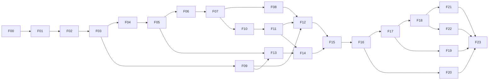

# Truffnotes Android Implementation Plan

> **For agentic workers:** REQUIRED SUB-SKILL: Use superpowers:executing-plans to implement this plan task-by-task. For explicitly authorized parallel execution, use superpowers:subagent-driven-development. Steps use checkbox (`- [ ]`) syntax for tracking.

**Goal:** Реализовать весь выбранный функционал Inkspace из `truffnotes.md`, с совместимыми деталями `goodnotes_red.md`, как быстрый Android-редактор редактируемых векторных заметок.

**Architecture:** Kotlin/Android multi-module Gradle project с `:tn-core`, независимыми функциональными модулями и сборкой в `:tn-runtime`/`:app`. Единственная модель документа и транзакций; Android Canvas/RenderNode для холста. Изменяемое состояние закреплено за actor/executor, обмен — bounded messages и immutable snapshots/leases.

**Tech Stack:** Kotlin/JVM, Jetpack Compose, Android Canvas/RenderNode/SurfaceView, Coroutines, AndroidX SQLite bundled driver/WAL/FTS5, kotlinx.serialization/CBOR, готовый Android PDFium binding в отдельном service process, SAF. Версии JDK/Kotlin/Gradle/AGP/SDK и dependencies фиксирует F00.

**Spec:** [Архитектура](../../architecture/android-workspace.md), [матрица требований](../../plan/requirements.md), [обязательные правила ИИ](../../plan/ai-execution.md), исходные [truffnotes.md](../../../truffnotes.md) и [goodnotes_red.md](../../../goodnotes_red.md).

Дата: 2026-11-05. Документ является планом: выполненных фаз и измерений приложения пока нет. Пользователь подтвердил Android-only и приоритет `truffnotes.md` при расхождениях. Архитектурные выборы ниже — предложения автора плана; решения пользователя этим не подменяются.

## Global Constraints

- Только Android; стартовый `minSdk=29`, production ABI `arm64-v8a`, emulator/test ABI `x86_64`; весь native stack проверяется на 4/16 KiB page sizes. Повышение minSdk/сужение GPU/device support требует отдельного решения, а не тихой правки build config.
- OCR, handwriting-to-text, math/LaTeX recognition, handwriting search, generative AI и neural handwriting enhancement исключены. Распознавание геометрических фигур включено.
- Полная модель и editability сохраняются в `.inknote`. Notebook/CanvasStudio — представления общей модели, а не разные редакторы с копированием документа.
- Любой функциональный production-модуль знает только `tn-core`; импорты реализаций соседей разрешены только `tn-runtime`. Android platform adapters и UI знают только core; app соединяет их с runtime.
- Единственный apply/validate/inverse, geometry pipeline штрихов, shaping текста, camera transform, command registry и storage protocol. Повтор одной бизнес-логики в UI/model/SQL запрещён.
- Действуют все limits, ownership rules и правила корутин и native dependencies [архитектуры](../../architecture/android-workspace.md). Нельзя ослаблять их для прохождения тестов.
- Все gates проверяются на фиксированных fixtures/сборках/устройствах с raw evidence. Файл и зелёная компиляция не означают готовый Android-функционал.

## Review Focus

Пять критичных условий, которые обязан покрыть owning task:

1. Kill/disk full между commit asset и DB transaction: ни одна подтверждённая revision не теряется; tests F03/F18/F23.
2. CANCEL, повтор pointer ID, смена ориентации/Surface во время письма: никаких phantom strokes/use-after-free; tests F04/F06/F23.
3. Два viewport, export/search/PDF reply после новых правок или закрытия: одна актуальная модель, stale outputs не применяются; tests F04/F14/F16/F17.
4. PDF/ZIP/image с повреждённым содержимым, огромными размерами или неподходящим URI: bounded memory, исходник цел, понятная ошибка; tests F11/F13/F14.
5. Заблокированные/скрытые layers, глубокие группы и objects вне страниц: операции/переключение UI не обходят locks и не удаляют данные; tests F07/F09/F19.

---

## 1. Как читать и исполнять

Сначала прочитать все четыре документа из `Spec`. Вначале реализуется контракт, затем владельцы функций, затем интеграция. Для каждого `Fxx` указаны зависимости, paths, API, последовательность и gate. Имена paths/tests/команд — целевые: они появятся в owning phase; сейчас их наличие не подразумевается.

Внутри фазы один пункт — один проверяемый deliverable. Если пункт велик, разбить его на задачи по одному user-visible поведению и одному циклу test → implementation → evidence. Нельзя закрыть общий пункт, выполнив только первый элемент перечня. Обязательные contract tests пишутся до сложной реализации; механические документы/build wiring не требуют искусственных unit tests.

Все unchecked boxes остаются unchecked до реального выполнения. `docs/evidence/Fxx/report.md` содержит доказательства. Изменения общих модульных контрактов в core/runtime выполняет интегратор; ownership описан в [правилах](../../plan/ai-execution.md). Code review каждой фазы проверяет её связанный код и failed cases, а не только diff.

## 2. Порядок, зависимости и параллельные ветви

Детальный список зависимостей каждой фазы ниже — авторитетный. Например, текст и контент разрабатываются независимо от PDF через fake ports; их **интеграция** с PDF закрывается F14. Renderer не ждёт готового store для unit/scene tests, но письмо не принимается до durable storage.

После стабильного F01/F02 можно вести одновременно: store; Android/runtime; pages/layers. После F04/F07: text; content; PDF; параллельно отдельно UI. После F14: Zoom/advanced UI; PDF/split; library/search; media. Один исполнитель сохраняет тот же порядок зависимостей. Performance measurements на одном устройстве одновременно не запускаются.

## 3. Релизные рубежи

- **G0: внутренняя сборка**, F00–F14 с выполненными зависимостями: создать Notebook, писать/стирать/выделять, pages, basic PDF, save/native/PDF export. Это не завершённый продукт и не все требования первой версии.
- **G1: первая принятая пользовательская версия**, F00–F18 и F22 плюс базовый профиль проверок F23: полный основной UI, layers/groups/Zoom, tags/search/versions/backups и Android integration. F19–F21 явно ещё не входят в этот рубеж.
- **G2: весь выбранный функционал**, все F00–F23, включая Canvas Studio, audio/replay/presentation и опциональную file sync. Только G2 позволяет сказать «весь функционал выбранного ТЗ реализован».

F23 можно запускать по мере готовности профилей, но фаза получает `verified` только на G2. Список исключённых самостоятельных продуктов и Apple-only функций остаётся в матрице, а не исчезает из отчёта.

`requirements.json` хранит `required_profiles` для каждого **подпункта**. G1 включает все capabilities F00–F18/F22 и acceptance1–47; G2 добавляет F19/F20/F21 и acceptance48–50. Например, R26.page-link нужен G1, R26.frame-link — G2. Laser/Timer реализуются уже F15, аудио/replay/presentation — F20. G1 использует W0–W6 и те же numerical gates применимых путей, исключая только не включённые Canvas/audio/sync UI cases; ограничения исключений перечисляются в отчёте. Зависимости полной F23 нужны для статуса всей фазы, а запуск G1-профиля до F19–F21 разрешён явно.

## 4. Фиксированный протокол производительности и надёжности

### Устройства и корпуса

F00 фиксирует реальные model/firmware/API/GPU/RAM в `docs/perf/devices.json`: D1 — Samsung S Pen, D2 — не Samsung с активным стилусом, D3 — нижняя целевая граница около 4 GiB RAM/60 Hz; один аппарат может совмещать D1/D3. Если D1/D2 имеют 90/120 Hz, измерять и этот режим. Эмуляторы API 29, 33 и текущий выбранный target API покрывают совместимость; emulator не заменяет hardware measurements.

`fixtures/workloads/manifest.json`: generator version, seed `20261105`, sizes, digests, expected counts; пользовательские документы не использовать.

| Корпус | Содержание | Проверяемый путь |
|---|---|---|
| W0 | Пустая библиотека / 1 пустая A4 | Cold launch, empty PSS, первый штрих |
| W1 | 100 pages ×100 strokes ×64 real samples | Обычное письмо, autosave, pan/zoom, eraser |
| W2 | 500 pages, всего 100000 strokes ×64 samples; ≤1000 visible | Lazy residency, open/jump/undo/search |
| W3 | 1000-page PDF, ≤500 MiB, text+vector+scan pages, links/outline | PDF streaming, tiles, text search/export |
| W4 | 10000 objects в одном Space, nested groups depth 32, 50×12MP images | Dense selection, group transform, image admission |
| W5 | 10000 library items, tags/folders, 100 MiB известного текста | Index/query/catalog paging |
| W6 | 30 минут пера 240 samples/sec + autosave + 2 viewport + PDF prefetch | Queues, thermal, memory growth, input continuity |

W4 — stress, не обещание 60 FPS при 10000 одновременно сложных видимых объектах. Он обязан завершаться без data loss/OOM; точный latency profile публикуется. W6 raw sample cadence фиксируется trace; playback не объявляется физическим pen-to-photon.

### Численные gates (проектные цели, ещё не измеренные результаты)

| Метрика | Условие/критерий |
|---|---|
| Frame time 60 Hz | W1/W2 при ≤1000 visible: p95 ≤16.67 ms, p99 ≤33.3 ms, missed frames <1% за 60 sec |
| 90/120 Hz | Те же scenes: p95 ≤11.11/8.33 ms для заявленной high-refresh поддержки; иначе честный 60 Hz fallback на этом профиле |
| Dispatch input batch | Main callback p95 ≤1 ms; engine ingest p95 ≤2 ms на 64-sample batch; никаких disk waits |
| Input → Canvas post | p95 ≤8 ms на W1 до завершения Canvas draw/post; marker не считается actual GPU submit или display latency |
| Pen-to-photon | p95 ≤50 ms при 60 Hz и ≤35 ms при принятой 120 Hz поддержке; high-speed camera ≥240 fps/100 strokes, метод и ошибка измерения в отчёте |
| Durable lag | p95 ≤200 ms для завершённых обычных strokes W1 на исправном private storage; все acks соответствуют fsync-backed commit |
| Открытие | Cold app → интерактивная library ≤2 sec p95; first editable viewport W2/W3 ≤3 sec p95; не ждать полного index/всех страниц |
| Page jump | Загруженный directory + cold page W2/W3: первый usable viewport p95 ≤300 ms |
| Spatial query | W2, lasso/eraser query до 1000 кандидатов: p95 ≤8 ms, без full-document geometry scan |
| Search | W5 metadata p95 ≤50 ms, FTS p95 ≤150 ms; FTS во время indexing p95 ≤250 ms; результат ≤100 rows |
| Controlled allocations | Все caps архитектуры соблюдены, admission выполняется до allocation |
| Process memory | Sum PSS app+PDF service ≤384 MiB на W1/W2, peak ≤512 MiB W3/W4; контролируемые graphics targets отдельно ≤96 MiB, фактическая HWUI/driver memory измеряется; RSS/PSS/managed/native/graphics раздельно |
| Утечки | После 100 open/close/rotate cycles retained controlled allocations ≤baseline+8 MiB; stabilized PSS delta ≤16 MiB, учитывая allocator/driver noise по raw trace |
| Crash safety | 0 потерянных/повреждённых durable transactions; минимум 1000 seeded fault schedules, kill/restart и real storage tests |
| Продолжительная работа | W6: no ANR/crash, no unbounded backlog, real input samples не пропадают; p95 frame/durable lag публикуется также для последней 5-min части |

Перед measured runs: release/profileable build, зафиксированный refresh/power/thermal state, 5 warmups +10 repetitions для interaction latency; cold start ≥10 независимых launches; search ≥100 queries разных классов. Для кадров — 60-sec trace ×3; для W6 — 3 runs. Raw trace + environment + script/hash обязательны. Значения не усреднять по разным устройствам; каждый заявленный профиль проходит отдельно.

Если baseline gate не достигнут — profiler → одна гипотеза → same-data comparison → оставить или откатить изменение. Нельзя снизить fixture size, увеличить бюджет или сменить слабый планшет и назвать это ускорением. F00 может выявить нереалистичный бюджет; изменение публикуется как изменение плана до реализации зависимых фаз, с причиной и согласованием существенного сужения.

## 5. Пошаговые фазы

### F00. Проверить стек на Android и заморозить измеряемую цель

**Depends:** нет. **Requirements:** R01/R34/R36. **Owns:** `docs/adr/0001-stack.md`, `docs/perf/{devices,protocol}.json`, `tools/spikes/android/`, `fixtures/workloads/`, начальный `requirements.json`.

**Consumes → produces:** исходное ТЗ → ADR с точными versions/ABIs/GPU capabilities, device matrix, fixture manifest, работающий минимальный spike. Spike не считается production редактором.

- [x] F00.1 Инвентаризировать каталог/архив, при возможности создать обычный Git repo без изменения read-only служебных файлов; зафиксировать fingerprints исходных спецификаций. Создать requirement/acceptance IDs по матрице.
- [x] F00.2 На минимальном Surface показать hardware Canvas path, pressure-driven draft и PDF tile через Kotlin ports; воспроизвести historical batch, CANCEL, surface destroy/recreate. Измерить dispatch/Canvas post/frame/PSS; хранить минимальные raw traces.
- [x] F00.3 Проверить PDFium на API29 arm64: render, text/search/link/outline, page import/delete/reorder и запись PDF с path/annotation. Проверить StaticLayout/TextPaintPlan→Canvas/PdfDocument для кириллицы/RTL/CJK/emoji, шрифты/IME, 16KiB alignment bundled libraries и APK load. Не оставлять неработающий PDF export на позднюю фазу.
- [x] F00.4 Зафиксировать toolchain/dependencies и исходники PDFium, checksums, лицензии/размер APK, список поддержанных GPU/axes. Выбрать один production pipeline; spike изолировать от Gradle production dependency graph.
- [x] F00.5 Заморозить корпуса и devices/protocol; проверить calibration timings и формулу quantiles на искусственных данных. Составить отчёт о выполнимости caps/latency, перечислить gaps.

**Gate:** spike запускается на реальном Android arm64 и 16KiB test image; перечисленные backend capabilities проверены, все версии/fixtures конкретны. `rtk proxy python3 tools/spikes/check_manifest.py` → exit 0 и все required entries; Android spike instrumentation → PASS. Если физического устройства нет — подготовка возможна, F00 hardware gate остаётся открытым.

### F01. Зафиксировать Gradle-модули и контракт ядра

**Depends:** F00. **Requirements:** R01/R28/R31/R34. **Owns:** root Gradle wrapper/version catalog/dependency locks/Detekt, `modules/tn-core`, `modules/tn-test-support`, `build-logic`/`quality`, `docs/contracts/core-v1.md`, CI JVM/Android jobs.

**API:** types/interfaces из архитектуры: DocumentRead/EditPlan/Mutation/ChangeSet/Limits/Outcome/actions/versions; AppliedRevision и DurableRevision различны. Test-support: bounded fake ports/test scheduler. Core API dump содержит только immutable/encapsulated public data.

- [ ] F01.1 Создать Gradle modules core/test-support/build-logic; typed IDs/units/errors/finite coordinates/limits, serialization/CBOR boundary. Contract tests `id_types`, `coordinate_roundtrip`, `limits`, `wire_rejects_nonfinite` проверяют несовместимые ID, inverse transform error ≤0.01pt и NaN/Inf rejection.
- [ ] F01.2 Определить typed payloads Notebook/Canvas, brush/shape/text/asset references и порты. Сгенерировать независимые fixtures v1; compile/serialization golden tests проверяют стабильность и unsupported required feature.
- [ ] F01.3 Реализовать `architectureCheck`, `apiCheck`, `requirementsCheck`, агрегаторы `jvmTestAll`/`androidUnitTestAll`, Detekt/ktlint; добавить отрицательные temporary fixture Gradle projects: api/implementation/test/variant/composite-build forbidden edge → FAIL. Не нарушать основной Gradle project ради проверки.
- [ ] F01.4 Зафиксировать публичный контракт, thread semantics, errors/cancellation/overflow. Core не содержит SQL/Canvas/Android и heavy implementations; добавить проверку запрещённых imports/dependencies.

**Gate:** `rtk proxy ./gradlew :tn-core:test :tn-test-support:test`, Gradle checks из правил и CI → PASS. Новая запрещённая edge/изменение API без version update детектируются тестом. Core contracts читаются отдельно от реализации любой feature.

### F02. Общая модель и атомарные транзакции

**Depends:** F01. **Requirements:** R07/R10/R15/R17/R28/R31. **Owns:** core `model/`, `edit/`; `modules/tn-runtime/src/test/kotlin/inkspace/runtime/CoreTransactionsTest.kt` после появления runtime, первоначально core tests.

**API:** `validatePlan(read: DocumentRead, plan: EditPlan, limits: Limits): Outcome<ValidatedPlan, EditError>`; `applyPlan(state: DocumentState, plan: ValidatedPlan): Outcome<AppliedEdit, EditError>`; `DocumentState.snapshot(): DocumentSnapshot`, `History.undo/redo` дают EditPlan. DocumentRead различает Present/NotResident/Missing.

- [ ] F02.1 До реализации добавить `atomic_plan`, `inverse_roundtrip`, `revision_precondition`, `locked_entities`, `group_cycles`, `missing_vs_nonresident`: malformed batch целиком отвергается, без частичной мутации.
- [ ] F02.2 Реализовать chunked document directory/immutable payload refs и mutation set. Не копировать всю коллекцию objects при каждом штрихе; измерить allocations на W2 single-object edit.
- [ ] F02.3 Реализовать точный ChangeSet old/new bounds, inverse deltas и logical gesture grouping. Рисование/resize/clear page дают по одной истории; failed/no-op plan не создаёт revision.
- [ ] F02.4 Добавить property test: seed-фиксированные последовательности create/style/transform/delete/group/layer/page → Undo всех → исходная модель; Redo → финальная; scene ordering/links/asset references валидны.
- [ ] F02.5 Ввести versioned persisted write-set/record codec и replay validation; identity/payload versions не зависят от JVM object layout. Один codec используется store/exchange. Snapshot pins измеряются вместе с history.

**Gate:** `rtk proxy ./gradlew :tn-core:test` → все перечисленные suite PASS, ≥10000 generated transaction sequences; single-edit incremental allocations не растут линейно со всеми payload bytes W2. Core не зависит от Android и не публикует mutable backing collections/arrays.

### F03. Надёжное локальное хранение и восстановление

**Depends:** F02. **Requirements:** R28/R29/R31/R32. **Owns:** `modules/tn-store`, `fixtures/corrupt/store`, `docs/contracts/storage-v1.md`.

**API:** core sealed StorageRequest: Open/Read/StageDraftChunk/Commit/Flush/Close/Backup/Version/Collect; StorageReply/DurableAck. Commit содержит write-set/expected durable base/TransactionId/staged assets. Store implements StoragePort/ResourcePort; provisional chunks не создают revision.

- [ ] F03.1 Создать storage contract tests `commit_ack`, `reopen`, `retry_idempotence`, `stale_base`, `disk_full`, `asset_before_ref`, `truncated_wal`, `backup_consistent`; fake FS/SQLite faults покрывают точки до/после fsync и DB commit.
- [ ] F03.2 Реализовать document DB migrations, один writer через BundledSQLiteDriver, bounded read jobs, WAL/FULL/foreign keys и atomic model+revision+transaction record. Commit retry не дублирует штрих.
- [ ] F03.3 Добавить immutable assets staging/fsync/checksum, reachability и lease-aware orphan GC. Отсутствующий/повреждённый asset не маскировать пустой картинкой.
- [ ] F03.4 Реализовать lazy page/space chunk loads, read lease и history spill; WriteSet replay проходит core validation, не создаёт второй reducer.
- [ ] F03.5 Выполнить 1000 seeded crash schedules в отдельном child process и reopen; проверить hashes/counts durable prefix, versions и SQLite integrity. Составить перечень платформенных fsync assumptions для Android проверки.

**Gate:** `rtk proxy ./gradlew :tn-store:testDebugUnitTest :tn-store:connectedDebugAndroidTest` → PASS; `rtk proxy ./gradlew faultStore -Pseed=20261105 -Pruns=1000` → 0 durable loss/corruption, bounded memory. JVM fault harness проверяет протокол; фактический driver на Android проверен instrumentation, real kill/disk tests продолжаются F04/F23. Saved status не выдаётся до durable ack.

### F04. Runtime, Android lifecycle и очереди

**Depends:** F00/F01/F02/F03. **Requirements:** R01/R05/R29/R36. **Owns:** `tn-runtime`, `tn-platform`, Gradle app/platform skeleton; `modules/tn-platform/src/main/kotlin/inkspace/platform/{InputTransport,SessionHandle,SurfaceHost}.kt`.

**API:** `Runtime.start(config: RuntimeConfig, ports: PlatformPorts): Outcome<AppGateway, StartError>`; core `AppGateway.trySend(command: AppCommand): Outcome<RequestId, SubmitError>`, `pollEvents(max: Int): EventBatch`, `closeAsync(): Outcome<RequestId, SubmitError>` (завершение — событие Closed после pending persistence). Все session/resource handles с generation; собственного foreign-function facade нет.

- [ ] F04.1 Реализовать executor ownership, byte admission и отдельные очереди durable/input/latest-view/control. Tests `overflow_policies`, `durable_order`, `no_starvation`, `shutdown_pending`, `stale_session` проверяют все caps/terminal events.
- [ ] F04.2 Создать MemoryGovernor/reservations и limited worker pool; tests `pins_counted`, `cancel_releases`, `lease_budget`. Не создавать thread/executor на feature/session.
- [ ] F04.3 Реализовать Kotlin typed transport/pooled batch handoff, FD/Surface/resource ownership. Tests `stale_handle`, `double_close`, `invalid_payload`, `mutate_after_handoff`, `pool_reuse_after_cancel`, `snapshot_alias` не должны крашить процесс, менять published snapshots или удерживать Activity. Coroutines confinement и immutable backing проверяются явно, без предположения о защите со стороны языка.
- [ ] F04.4 Реализовать save watermark/unsaved state, Activity rotation/resize/background/process restore; `SurfaceEpoch` и acknowledged teardown. Lifecycle tests во время commit/recreate не теряют durable prefix.
- [ ] F04.5 Добавить Android baseline screens с Kotlin AppGateway/session connection; progress/save/error states и отказ ввода при pending overflow, без UI thread blocking. Profile callback durations.

**Gate:** runtime/platform suites PASS; instrumented ≥100 rotation/surface cycles и kill/reopen сохраняют durable hashes; очередь overflow даёт явный статус; no leaked Activity/Surface/buffer leases. JVM protocols — deterministic coroutine tests и stress/linearizability checks; native зависимости — поддержанный sanitizer/debug build. Все tests/assemble/lint из правил проходят.

### F05. Единый renderer, culling и ресурсные caches

**Depends:** F02/F04. **Requirements:** R05/R07/R21/R34. **Owns:** `tn-render`, drawing caches внутри него; scene/input fixtures.

**API:** core RenderRequest/RenderReply/Scene/PathArtifact/TextLayout/TileArtifact; `Renderer.render(request: RenderRequest): Outcome<FrameStats, RenderError>` только render executor. RenderPort dispatch-ит Draw/Snapshot/PdfOverlay. CanvasReplay один для Surface, image и PdfDocument targets; export target имеет собственные mutable Canvas/Paint на bounded export executor.

- [ ] F05.1 Ввести scene/golden tests camera transforms, clipping/z-order/highlighter compositing, layer opacity, camera-relative Double→Float и draft→committed consistency. Geometry provider пока fake, без повторного brush implementation.
- [ ] F05.2 Реализовать culling, cached Android Path/RenderNode, grouped Canvas draw commands, dirty regions и cache keys по content versions/scale/font/resources. `same_scene_pan` не rebuilds всю геометрию.
- [ ] F05.3 Добавить общий CPU/graphics budget, tile/RenderNode eviction, max2 snapshots и acknowledged Surface/resource release. Отказ memory admission/invalid Surface/resize возвращает typed event; allocator OOM не считается надёжно восстанавливаемой ошибкой. Проверить managed allocations/GC и отсутствие per-sample объектов; графические allocations SDK измерять отдельно от собственных estimates.
- [ ] F05.4 Проверить W1/W2 синтетическими immutable scene fixtures; hardware Canvas каждого заявленного device/API профиля, destroy/recreate; сохранить raw frame/allocation stats.

**Gate:** `rtk proxy ./gradlew :tn-render:testDebugUnitTest :tn-render:connectedDebugAndroidTest` и Android renderer tests → PASS; deterministic images сравниваются в согласованном color space, антиалиас tolerance ≤1px edge/≤2 per 8-bit channel вне edge. W1/W2 frame и graphics/PSS budgets раздела4 соблюдены для renderer scene. Physical pen latency ещё не заявляется.

### F06. Реальный рукописный ввод

**Depends:** F03/F04/F05. **Requirements:** R06/R07/R13/R31. **Owns:** `tn-ink`, tn-platform MotionEvent adapter; core input fixtures, runtime wiring интегратором.

**API:** `InkEngine.ingest(batch: InputBatch, ctx: InputContext): Outcome<InkOutput, InputError>`; GeometryPort.paths для всех brush kinds. RealSample и PredictedSample — разные core types; InputBatch lease не выдаёт mutable backing после handoff.

- [ ] F06.1 Добавить replay fixtures `historical_points`, `pointer_reuse`, `mixed_finger_pen`, `cancel_stream`, `flag_canceled`, `axes_missing`, `long_stroke`, `prediction_replaced`. Assertions: реальные samples сохраняются в порядке, canceled draft не записан, prediction отсутствует в DB/Undo.
- [ ] F06.2 Реализовать обработку all Android touch actions/hover/history/buttons/axes с capability/fallback. Palm input не отменяет завершённый stroke другого pointer. Passive pen честно определяется как touch.
- [ ] F06.3 Реализовать Ball/Fountain/Brush/Pencil/Highlighter через один versioned pipeline: smoothing preserves intentional corners, pressure/tilt, ends/style/pattern/opacity. Длинный logical stroke имеет resident window≤8MiB, старые chunks spool-ятся в provisional store staging без revision, UP публикует refs одним Undo, CANCEL делает staging collectible. Test `long_stroke` превышает window минимум в10раз, проверяет bounded RAM и полную последовательность real samples после reload; diskfull spool не превращается в тихое усечение линии.
- [ ] F06.4 Подключить draft renderer и core commit/Undo/store; геометрия черновика и финала совпадает на реальных samples. Протестировать pen+save+scroll без Main I/O.
- [ ] F06.5 Проверить stylus-only/finger-draw/navigation, temporary eraser button и hover на D1/D2. Показать capability отсутствие pressure/tilt, а не искусственные fake readings.

**Gate:** ink/transport/replay suites PASS; real stylus tests D1/D2; W1 callback/ingest/durable/pen latency gates выполнены, 0 phantom strokes при CANCEL и 0 предсказанных saved points. Результат можно снова открыть и редактировать как vectors.

### F07. Выделение, transforms, группы и ластик

**Depends:** F02/F06. **Requirements:** R08/R09/R10/R31. **Owns:** `tn-objects` selection/hit_test/erase/transform/group; clipboard bundle contract в core, content codec позже F11.

**API:** `ObjectPlanner.plan(read: DocumentRead, action: ObjectAction, ctx: PlanContext): Outcome<EditPlan, FeatureError>`; SelectionQuery/SelectionSet; GeometryPort инъектирует runtime, прямой зависимости на ink нет.

- [ ] F07.1 Tests `lasso_contains_intersects`, `add_subtract_selection`, `hidden_locked`, `transform_inverse`, `nested_group_once`, `z_order`, `segment_interpolation` до реализации. Mixed selection не объединяет разные Textbox в новый текст.
- [ ] F07.2 Spatial bounds query → precise hit test; full/partial freehand/rectangle selection, layer/type filters. Заблокированные/скрытые entities обрабатываются по policy core, не по UI check.
- [ ] F07.3 Реализовать move/rotate/scale/flip/style/delete/duplicate/z-order и nested groups с depth≤32/cycle reject; preview не мутирует document на каждый MOVE. Commit — одна logical operation.
- [ ] F07.4 Реализовать Precision/Segment/Stroke/Object eraser. Segment интерполирует coordinates/pressure/time и сохраняет остатки, обычные stroke modes не стирают images/PDF/text; Object mode отдельно и явно. Filters/active vs visible unlocked layers применяются до clipping.
- [ ] F07.5 Реализовать in-document copy/cut/paste с remap stable IDs/attachments/links; cross-doc execution использует TransferId F16. Добавить undo property tests для partial erase и nested transforms.

**Gate:** objects/core integration PASS; 10000 generated edits undo/redo; W2 spatial gate ≤8ms для заданного candidate count; changing locked layer через любой intent отвергается атомарно. Сохранённый стёртый/преобразованный штрих восстанавливается без растеризации.

### F08. Геометрические фигуры и автомат жестов

**Depends:** F06/F07. **Requirements:** R11/R12/R13. **Owns:** objects shape/snap; ink gesture arbitration; ruler/protractor overlay contracts; Android tool controls лишь wiring.

**API:** ShapeAction внутри ObjectAction; GestureProposal/GestureDecision/guide/connector contracts. `ShapeRecognizer.recognize(stroke: StrokeData, config: RecognitionConfig): ShapeCandidate` без handwriting/ML recognition.

- [ ] F08.1 Freeze positive/negative gesture corpus: straight/circle/square/ellipse/triangle/polygon/arc/curve/ambiguous handwriting, hold times, circle-lift-rehold и scribble. Tests детерминированы fake clock и реальными input traces.
- [ ] F08.2 Реализовать геометрические fit/corner/closure criteria и редактируемые shape payloads, rounded rect/fill/vertices/arrowheads. Не распознавать слова/формулы.
- [ ] F08.3 Реализовать connector anchors/control points, следование перемещению/resize targets, delete policy для dangling endpoint и quick-diagram create+connect одной транзакцией.
- [ ] F08.4 Один gesture arbiter соблюдает приоритеты ТЗ: active operation/explicit tool/navigation/geometric gesture/ink; ambiguous input сохраняет исходник. Scribble удаляет только подходящие pen strokes; Circle selection не запускает shape одновременно. Отдельные fixtures для double-tap двумя пальцами Undo и тремя Redo не путаются с page double-tap zoom; системный перехват жеста имеет приоритет.
- [ ] F08.5 Реализовать ruler two-edge snap/angle/position/cm-inch, protractor/guides/snap-grid/angle/object alignment; overlay transform общий с документом. Настройки enable/thresholds передаются typed config.

**Gate:** `gesture_corpus` true positives ≥95%, false positives ≤0.5% на ≥2000 замороженных отрицательных samples; ambiguous set 100% сохраняет original. Все shape kinds/manual edits, connector move/delete, ruler numerical tests PASS; Undo каждого распознанного жеста возвращает исходное состояние одним действием. Настройки threshold не подгоняются на acceptance corpus.

### F09. Страницы, слои, бумага и навигационная структура

**Depends:** F02/F03. **Requirements:** R12/R15/R16/R17/R31. **Owns:** `tn-pages`, page/layer/template fixtures, core capability additions через интегратора.

**API:** `PagePlanner.plan(read: DocumentRead, action: PageAction, ctx: PlanContext): Outcome<EditPlan, FeatureError>`; TemplateDescriptor/PageResizePreview/OutlineNode/FrameDescriptor. File decoding через ResourcePort/PdfPort.

- [ ] F09.1 Tests `page_order_ids`, `resize_no_loss`, `clear_vs_delete`, `layer_lock`, `merge_preserves_order`, `template_snapshot`, `outline_depth`. Перестановка страниц не меняет PageId/link target.
- [ ] F09.2 Реализовать add/insert/duplicate/delete/reorder/rotate/format/background и bulk plans; все элементы batch проверяются до изменения. Размер A4/A5/Letter/custom выражен в core units.
- [ ] F09.3 Реализовать три resize policies с preview: keep geometry, scale content, allow outside. Ни один не удаляет автоматически вышедшие за границы objects. Предпросмотр использует ту же матрицу, что commit.
- [ ] F09.4 Layer CRUD/duplicate/hide/lock/reorder/opacity/merge/group и move objects; default active layer, hidden не выбирается обычным lasso. Merge сохраняет visual order/opacity: если невозможно без изменения semantics — явный preview/отказ, не молчаливая растризация.
- [ ] F09.5 Templates/grids/covers/defaults; bookmark и outline CRUD/reorder/subnodes (max32, минимум 3). Импортированная template версия snapshot-ится на странице, последующая замена в library её не меняет.

**Gate:** pages/core/store suites PASS; все варианты page resize и layer delete/merge undo round-trip; reload сохраняет order/locks/style/bookmarks. На W2 page directory lazy, без загрузки всех strokes ради thumbnail list. Frames metadata предусмотрены, UI F19 не нужен для проверки.

### F10. Печатный текст, шрифты и Android IME

**Depends:** F04/F07. **Requirements:** R19/R39. **Owns:** `tn-text`, Android IME host adapter, text contract fixtures; renderer лишь подключает готовый TextLayout через интегратора.

**API:** `TextPlanner.plan(read: DocumentRead, action: TextAction, ctx: PlanContext): Outcome<EditPlan, FeatureError>`; TextPort.layout возвращает TextLayout/TextPaintPlan. ImeEdit/TextInputMap — core types. Единый tn-text преобразует Android UTF-16 offsets/CBOR UTF-8, bounds/selection; renderer проигрывает готовый paint plan без второго layout.

- [ ] F10.1 Tests `emoji_surrogate`, `combining_grapheme`, `rtl_mixed`, `cjk_composition`, `ime_cancel`, `stale_composition`, `keyboard_focus`, `font_fallback`. Нельзя разрезать grapheme/surrogate или применить composition в другой объект после смены focus.
- [ ] F10.2 Реализовать единый rich text model/selection/runs, bold/italic/underline/strike/highlight/font/size/color/alignment/spacing/list/indent. Default style и Pin Text Tool — settings, не отдельный текстовый движок.
- [ ] F10.3 Реализовать IME batch/composition/commit/delete surrounding/selection, native accessibility text node. Undo группирует composition как одно логическое изменение; клавиши инструмента не крадут буквы у focused field.
- [ ] F10.4 Единый StaticLayout/MeasuredText layout, TextPaintPlan/cache/font digest для Textbox, Shape label и Sticky; line wrap и hit-testing соответствуют визуальным glyph positions. Export получает тот же TextLayout через port.
- [ ] F10.5 Full-page typing использует тот же payload с page-bound container; overflow предупреждается, не обрезается и не переносится на новую страницу автоматически. Проверить system/imported font fallback и safe font resource limits.

**Gate:** text unit/golden tests и Android IME instrumentation PASS на двух разных IME; кириллица/латиница/emoji/RTL/CJK сохраняются/reload без потерь. Selection/cursor после transforms совпадают с layout; один input action не создаёт две истории UI/model. Font/layout caches входят в общий cap.

### F11. Изображения, Elements, Sticky и Tape

**Depends:** F03/F07/F10. **Requirements:** R18/R20/R38. **Owns:** `tn-content`, Android picker/camera/clipboard adapters, image fixtures.

**API:** `ContentPlanner.plan(read: DocumentRead, action: ContentAction, ctx: PlanContext): Outcome<EditPlan, FeatureError>`; ObjectBundle(schema/objects/assetRefs/rootIds); ResourcePort/TextPort/RenderPort, без sibling implementation types.

- [ ] F11.1 Tests `image_orientation`, `freehand_crop_mask`, `decode_bomb`, `bundle_remap`, `sticky_attachment`, `tape_reveal_readonly`, `gif_budget`. Huge/invalid dimensions отвергаются до allocation; cropped source сохраняется immutable.
- [ ] F11.2 Gallery/SAF/camera/clipboard/drag-drop → staged asset → Image object; rect/freehand crop, alpha, flip, transform/lock через core. Downsample/tiles по требуемому масштабу; default image import limit 100MP с явным отказом или downsample preview, CPU decode cap 32MiB сохраняется.
- [ ] F11.3 Elements collections create/rename/reorder/move/delete и сохранение editable mixed groups; вставка remap IDs и внутренних links/attachments. Копия элемента не меняет исходную коллекцию. Selection screenshot/copy-as-image идёт через core render/export port; он дополняет editable copy, не заменяет её.
- [ ] F11.4 Sticky: rich text/common style, attached child strokes/shape/image, collapse/expand/lock/color. Parent transform не применяется к ребёнку дважды; сохранение/reload/undo сохраняют attachments.
- [ ] F11.5 Tape как отдельный editable stroke/маска с color/pattern/straight option и ephemeral reveal state per view; reveal доступен read-only, delete/remove-all через document transaction. Local GIF animated decoder ограничен по frames/decoded bytes; невидимые GIF приостановлены, static export берёт выбранный poster frame.

**Gate:** content/core/store integration PASS; camera denial/revoked URI/clipboard without permission даёт recoverable error; W4 не декодируется целиком в RAM. Editable bundle round-trip сохраняет geometry/styles; Tape/Sticky preview не меняют document при простом раскрытии. Публикация/экспорт этих состояний проверяется F14.

### F12. Полноценные библиотека и основной Notebook UI

**Depends:** F04/F06/F07/F08/F09/F10/F11. **Requirements:** R02/R03/R04/R05/R24/R36. **Owns:** `tn-workspace`, базовый `tn-library`, `modules/tn-ui/{library,notebook,common,settings}`, navigation в app.

**API:** `Workspace.dispatch(action: ViewAction): ViewUpdate`; ViewState/ViewportId/TabId/CommandDescriptor; `LibraryService.submit(action: LibraryAction): Outcome<OperationId, LibraryError>`. UI получает core AppGateway; command registry един для gestures/buttons/keys.

- [ ] F12.1 Создать UI cases каждого из исходных acceptance 1–18 и47; tests toolbar↔keyboard dispatch одинакового command ID, tab dirty state, readonly denies core changes, Focus camera preserved.
- [ ] F12.2 Реализовать Documents/Grid/List/Favorites/Recent/Templates/Trash, virtualized rows/tiles и thumbnail jobs; first `+ New` — Notebook с name/cover/paper/size/orientation/scroll defaults. Create открывает editable page с активным Pen.
- [ ] F12.3 Tabs open/switch/close/reopen/reorder/overflow/restore; cold tabs хранят metadata/view state, не гарантируют permanent residency модели. Closing dirty tab не бросает pending save.
- [ ] F12.4 Navigation/Toolbar/active tool/object menu/sidebar Pages/Outline/Bookmarks/Layers; single/repeat/long press, insert→Lasso и Text pin behaviour. Single tool/menu route через общие commands.
- [ ] F12.5 ReadOnly, Focus, portrait/landscape, vertical/horizontal scroll, insets/back; adaptive side panel overlay/dock. Выбранный tool/camera/selection восстанавливается после rotation без копирования объектов.
- [ ] F12.6 Базовые folder/create/rename/favorite/trash/restore открываются из long-press и mass select; operation journal API уже используется, bulk расширяется F17. Разделы не являются пустыми демонстрационными экранами.

**Gate:** Android UI suites проходят на tablet portrait/landscape/split size; исходные cases1–18/47 зелёные с evidence; 100 tabs restore не держат 100 resident documents. Есть рабочий offline create→write→undo→close→kill→reopen путь. Advanced PDF и G1 ещё не заявляются.

### F13. PDF backend, импорт, tiles и чтение текста

**Depends:** F03/F04/F05/F09. **Requirements:** R21/R27/R33. **Owns:** `tn-pdf`, Android isolated PDF service IPC/FD adapter; PDF corpus и service config runtime.

**API:** PdfPort и sealed PdfRequest Open/Info/Tile/Text/Search/Links/Outline/Close; bounded PdfReply. PdfPageRef/PdfTextSpan в core; IPC lengths/buffer ownership проверяются с обеих сторон. PDF handles доступны только single-thread BindingAdapter.

- [ ] F13.1 PDF fixtures: text/vector/scan, encrypted/password failure, rotated/cropped boxes, missing fonts, damaged/xref, huge page dimensions, named links/outline. Tests проверяют известные counts/text boxes/hash исходного asset.
- [ ] F13.2 Bundled PDFium только в service; single-thread все API/handles/callbacks, lifecycle close order и cancellation. Service crash не крашит engine, новый epoch не принимает старый tile.
- [ ] F13.3 Open via SAF/receive-intent/FD: nonseekable provider потоково staging-копируется; page descriptors появляются до рендера всех страниц. Raster tiles по viewport, consistent PDF→Doc transform и rotation/crop.
- [ ] F13.4 Import PDF как отдельный document/insert page range/background reference/on-canvas resource; аннотации обычные editable objects. Erase аннотации не меняет исходный PDF asset.
- [ ] F13.5 Text extraction/select-copy/search existing text, thumbnails, internal/external links, outline/bookmarks/back position. Для scan без text layer честно пустой text result, без OCR.

**Gate:** PDF binding unit tests и Android isolated-service tests PASS; W3 first viewport≤3sec, page jump≤300ms и memory caps; при сбое PDF service durable notebook сохранён. `PdfPageRef`/transforms проверены hit-test/selection overlay. SHA исходного PDF до/после аннотирования совпадает.

### F14. Переносимый формат, импорт и все базовые виды экспорта

**Depends:** F03/F09/F10/F11/F13. **Requirements:** R16/R20/R28/R33. **Owns:** `tn-exchange`, `docs/contracts/inknote-v1.md`, export integration в runtime; PDF writer внутри tn-pdf, drawing caches/render reuse через ports.

**API:** `Exchange.start(request: ExchangeRequest, ports: ExchangePorts): Outcome<JobId, ExchangeError>`; ExportSource.Durable/Recovery дают bounded SnapshotReader; ExportMode: Native/VectorPdf/FlattenedPdf/StandardAnnotations/PNG/JPEG. ExchangePorts содержит core interfaces, PdfOverlay запрашивается через RenderPort.

- [ ] F14.1 Tests `native_roundtrip`, `snapshot_export`, `recovery_pending_disk_full`, `archive_traversal`, `expanded_quota`, `bad_hash`, `unsupported_schema`, `canceled_import`, `output_short_write_nonatomic_provider`, `reimport_same_id`. Native ID collisions: open matching library generation либо explicit import-as-copy с remap; не перезаписывать существующий document.
- [ ] F14.2 Потоковый ZIP manifest+document.cbor+bounded record chunks+reachable assets; deterministic manifest ordering/digests, один core codec и encoder для Durable/Recovery source. Disk-full test: writer получает ENOSPC, есть pending stroke/image/style, export на новый доступный SAF output без внутреннего temp; reopen содержит точную applied revision и все pending edits/assets, исходный saved watermark не меняется. Сравнивать canonical model/asset hashes, не SQL layout.
- [ ] F14.3 Реализовать page/range/region/full/multi-doc archive и chosen layers; PNG/JPEG tiled rendering в output, native object bundles/collections/template import-export. Multi-page PDF template по умолчанию first page с явным preview/выбором.
- [ ] F14.4 PDF export использует GeometryPort/TextPort, общий CanvasReplay через RenderPort.PdfOverlay и PDF writer port: Android PdfDocument создаёт по одной vector/text overlay page и закрывается после передачи writer, PDFium объединяет overlay с исходником; paths/text сохраняют масштабы, flattened appearance удаляет редактируемость аннотаций, стандартные поддержанные annotations — настоящий PDF annotation object. Никаких собственных повторных brush/shaping алгоритмов.
- [ ] F14.5 Сохранять PDF links/outline там, где mapping страниц существует; unsupported annotation/texture/font fallback перечисляется в preview/report. `.inknote` сохраняет всё. Flattened означает объединение appearance, а не обязательное bitmap каждой страницы; source PDF не растрируется без причины.
- [ ] F14.6 Проверить Sticky collapsed/expanded, Tape hidden/revealed и visible-layer export policy: режим выбирается пользователем и фиксируется lease, исходник не меняется. Данные под Tape не считаются удалёнными/redacted. Для обычного и recovery export применяется safe output policy: новый URI/имя; overwrite только при доказанной atomic replacement capability. Short write/cancel на non-atomic provider сохраняет старый файл, incomplete output не считается успешным.

**Gate:** native/import/export suites PASS; все R33 formats/scopes имеют fixtures; PDF открывается минимум двумя независимыми viewers и проверяется structural checker: paths/text/annotations реально соответствуют режиму, links/outline targets существуют. Export во время редактирования имеет одну revision. Short write/cancel не уничтожает старый output; native round-trip сохраняет editable types/IDs/assets.

### F15. Zoom Window, настройка инструментов и полный основной UI

**Depends:** F08/F10/F11/F12/F13/F14. **Requirements:** R04/R07/R08/R13/R14/R38/R39. **Owns:** workspace zoom/settings/commands; `tn-media` начальные laser/timer модули; Android toolbar/settings/zoom; ink/content только настройки через интегратора.

**API:** core ViewAction SetToolbarLayout/OpenZoom/MoveZoom/ZoomAdvance/SetToolConfig/SetGestureConfig; ZoomViewState/ToolPreset/Palette/CapabilityState. Zoom — тот же engine/document session, новый viewport.

- [ ] F15.1 Tests `zoom_coordinate_equivalence`, `zoom_advance_no_gap`, `zoom_pdf_rotation`, `toolbar_orientation`, `tool_return`, `palette_isolation`, `readonly_tape`, `gesture_reset`. Одинаковый path из обычного view/Zoom в Doc units отличается≤0.01pt.
- [ ] F15.2 Zoom box/window resize/zoom/move/indicator/pin/collapse, auto-advance right/next-line/line-height; переход не переносят незавершённый stroke между разными transforms. Overlay работает поверх Notebook/PDF и не создаёт copy page.
- [ ] F15.3 Toolbar reorder/hide/show/overflow/reset, sizes/compact/dock top-bottom, separate orientation settings, Focus float/auto-hide/sides и Undo/Redo position. Lasso остаётся доступным; приложение не требует копировать неизменяемость панели Goodnotes, если Inkspace её настраивает.
- [ ] F15.4 Tool style/thickness/smoothing/pressure/tilt/ends/pattern/eraser modes/filters/autodeselect; custom presets. Отдельные color palettes: initial3/max12, HEX/wheel/drag/reset; eyedropper читает документ/PDF/image color в явном color space, не экран другого приложения.
- [ ] F15.5 Gesture enable/timing/sensitivity, palm posture/preferences, finger draw и stylus buttons/capabilities; disabled hardware action объясняется capability. Начальный tn-media реализует Laser Dot/Trail с TTL, Timer/Stopwatch/laps/history по монотонному времени; это рабочие Accessories, не placeholders до F20. Tests `laser_ephemeral`/`timer_background` проверяют отсутствие document mutation и двойного таймера после recreate. Ни один setting не скрывает незавершённую обязательную функцию.

**Gate:** real stylus Zoom/PDF/toolbar suites PASS, no duplicate strokes/history/geometry; resize/dock сохраняет camera anchor и не перекрывает доступный canvas. Полный перечень R04/R14/R39 settings сохраняется/reload/reset без влияния палитры одного инструмента на другой.

### F16. PDF Workspace, cross-document операции и Split View

**Depends:** F07/F09/F13/F14/F15. **Requirements:** R15/R22/R23/R33/R36. **Owns:** pdf structure/export; workspace split; library transfer journal; runtime coordinator tests, Android split UI.

**API:** sealed PdfStructureAction Merge/Extract/Split/Insert/Delete/Duplicate/Reorder/Rotate → immutable asset/page-ref plan; TransferRequest(id/source/destination/bundle/mode); SplitViewState с независимыми ViewportId.

- [ ] F16.1 Tests `two_views_one_revision`, `independent_cameras`, `transfer_fault_matrix`, `transfer_undo`, `pdf_page_mapping`, `pdf_annotation_roundtrip`, `back_to_source`. Один документ во втором viewport не получает второго writer/history.
- [ ] F16.2 PDF add/delete/duplicate/reorder/merge/extract/split/rotation меняют doc page refs и при materialized export remap ссылки/outline. За пределами выбранного диапазона ссылки показываются unresolved/сохраняются как явная external reference, не ведут на случайную страницу.
- [ ] F16.3 PDF standard annotation import/export coverage table: Ink, Highlight, Text/FreeText, supported link annotations. Unsupported kinds сохраняются в оригинальном PDF или описываются в export report; unsupported standard mode не выдаётся за полную native editability.
- [ ] F16.4 Internal split: PDF+Notebook, two notes, two pages one note, two regions; pan/zoom/tool focus и selection origin согласованы. Drag between views по умолчанию copy; move явно включает destination-first durable TransferId saga.
- [ ] F16.5 Cross-doc pages/objects/elements: remap IDs/assets/links, durable destination before source deletion, recovery каждого saga stage. Coordinated Undo возвращает исходное состояние и не удаляет новые несвязанные edits другого документа.

**Gate:** transfer crash schedules ≥1000 без потери обоих экземпляров, recovery идемпотентен; all PDF structure cases reload/export правильны. Два viewport во время write/export/search видят одну revision после delivery; разные камеры не меняют сохранённую геометрию. PDF/native exports проверены как F14.

### F17. Библиотека файлов, теги, ссылки и быстрый поиск

**Depends:** F10/F12/F13/F16. **Requirements:** R24/R25/R26/R27/R30. **Owns:** `tn-library` advanced operations/migrations, `tn-search`, workspace search/navigation, Android library/search UI.

**API:** LibraryAction/OperationId; IndexFacts(document/durableVersion/fields); SearchRequest(query/index/overlay generations, filter/cursor/limit); SearchPage(hits/nextCursor/stamp); LinkTarget Document/Page/Frame/Object/Region/Pdf/Url.

- [ ] F17.1 Tests `folder_cycle`, `bulk_partial_failure`, `trash_restore_collision`, `rename_link_stable`, `stale_search`, `dirty_overlay_precedence`, `index_rebuild`, `search_cursor_generation`. Запрос результатов старой generation/cursor возвращает stale error/reset, не дублирует строки.
- [ ] F17.2 Nested folders/tags (цвет/иерархия), CRUD/copy/duplicate/move/trash/restore/favorites/archive/properties и bulk operation journal. Drag target folders и edge autoscroll используют ту же LibraryAction, а не file mutations из UI. Smart collections — сохранённый typed filter, без физических копий.
- [ ] F17.3 Единые typed link targets с stable IDs, back/forward stack/source PDF region; rename/move не меняет target. Внешние URL открываются через Android intent после проверки scheme; embedded PDF JavaScript не выполняется.
- [ ] F17.4 Index facts из model ChangeSet + PDF text extraction через PdfPort; SQLite FTS производный. Core data/metadata не дублируются как второй editable источник. Dirty overlay применяется до ranking/pagination, в том числе исключая удалённые/изменённые совпадения persisted index.
- [ ] F17.5 Latest-query mailbox, cancellation/stamp validation, Unicode normalization/tokenization и bounded top-k; metadata/FTS/search-in-doc/global filters, precise jump/highlight и ≤100 rows/page. Indexing paused/canceled под нагрузкой пера, не блокирует UI.
- [ ] F17.6 Отказ storage одного элемента bulk не превращает всю операцию в «успех»: report по item IDs; recovery повторяет оставшиеся steps идемпотентно. Undo trash/move использует journal, при конфликте имени предлагает разрешение без overwrite.

**Gate:** library/search/integration PASS; W5 latency/row caps и memory budgets выполнены, rename/move links working; rebuild index даёт тот же canonical result set. Все fields R27 покрыты, scans/handwriting не обещают OCR. Bulk interruptions/URI errors не теряют документы и не создают невидимых permanent deletes.

### F18. Версии, резервные копии, внешняя библиотека и миграции

**Depends:** F03/F14/F17. **Requirements:** R28/R29/R30/R32. **Owns:** store versions/migrate/gc, exchange backup, library retention/restore journal, Android SAF publisher; `fixtures/documents/v1` и migration fixtures.

**API:** VersionRequest Create/List/Restore/Copy, BackupManifest, PublishRequest(location/expectedGeneration/exportLease), PublishState/RestoreRequest. Library backup: catalog snapshot + portable documents/assets/settings с per-entry digests.

- [ ] F18.1 Tests `version_restore_new_revision`, `deleted_page_recovery`, `backup_during_edit`, `restore_stage_failure`, `retention_pins`, `migrate_failure`, `provider_nonatomic`, `permission_revoked`, `external_changed`. Fault injection до/после каждой точки публикации/миграции.
- [ ] F18.2 Checkpoint/list/preview/restore/copy versions; restore не затирает исходную версию и не меняет current state до успешного сохранения. Реализовать 20 auto versions/doc +512MiB global target, pinned exceptions и понятный disk-space status.
- [ ] F18.3 Backup/export whole library со структурой папок/tags/elements/templates/settings; consistent catalog generation и document revisions фиксируются manifest. Для большого backup documents копируются потоково, не все snapshots pin-ятся в RAM одновременно.
- [ ] F18.4 SAF chosen folder через provider capabilities: versioned publish/commit manifest, local/external save states отдельно. Потеря grant/незаписанный хвост не уничтожают предыдущую подтверждённую generation. Restore сначала staging+validate всех entries, потом журналируемая публикация.
- [ ] F18.5 App trash TTL30days/manual clear/permanent delete с user action, lease-aware GC и no silent pinned delete. Exported whole-library structure восстанавливается на втором clean install.
- [ ] F18.6 Migration v1→v2 fixture (можно synthetic schema extension) на копии/transaction-safe storage; simulate disk full/kill. Unknown required features оставляют исходник неизменным/read-only, downgrade не выкидывает объекты. Лишь успешная migration получает new schema marker.

**Gate:** backup/restore/migrations/fault suites PASS; на двух разных SAF providers, включая non-atomic fake provider, restore совпадает с manifest/canonical models; clean install может открыть standalone `.inknote` без исходного catalog. 0 durable loss при kill/diskfull; по крайней мере один реальный device restart с persisted URI grant и его отзывом.

### F19. Canvas Studio, бесконечные пространства и Frame

**Depends:** F08/F09/F12/F16/F17. **Requirements:** R12/R23/R26/R35. **Owns:** workspace canvas view/minimap/panels, pages Frame operations, Android Canvas UI; никакого нового document/render engine.

**API:** ViewAction.SetInterfaceMode/CanvasViewState/BoardId; PageAction CreateFrame/UpdateFrame/FrameFromSelection; NamedRegion/FrameDescriptor. Renderer/geometry/document engine остаются общими.

- [ ] F19.1 Tests `mode_switch_hash`, `outside_page_preserved`, `undo_survives_mode`, `frame_no_object_copy`, `multiple_boards`, `large_coordinates`, `minimap_bounded`. Полная последовательность Notebook→Canvas→Notebook не меняет payload hashes/coordinate IDs/history.
- [ ] F19.2 Infinite Space/Boards create/reorder/navigate, named regions и world-coordinate envelope; floating panels/minimap. Миникарта использует decimated bounded summaries, а не вторую полную сцену всех объектов.
- [ ] F19.3 Frame create around selection/resize/orientation/background/template/name/export order, export region через тот же exchange port; пересечение frames не дублирует объекты при сохранении.
- [ ] F19.4 Notebook в Canvas Studio отображает страницы в layout transform без переписывания local geometry; arbitrary Canvas в Notebook UI показывает frames/pages и сообщает о внестраничном содержимом. Если постраничного представления нет — явное объяснение/создание Frame, не удаление объектов.
- [ ] F19.5 Advanced guides/alignment/group editing и several regions используют existing ObjectPlanner/renderer; режим по документу запоминается. Split/Zoom не создают отдельной модели.

**Gate:** исходные acceptance48–50 PASS; mode switch round-trip после перезапуска и Undo/Redo сохраняет canonical geometry/assets/layers/outside objects. W2/W4 budgets не умножаются на число boards/frames/viewports; численная ошибка layout/inverse≤0.01pt во всём заявленном envelope.

### F20. Аудио, Note Replay, Laser, таймер и презентация

**Depends:** F06/F14/F15/F16. **Requirements:** R37/R38. **Owns:** `tn-media`, Android audio/display adapters, media UI и replay timeline contract.

**API:** sealed MediaCommand StartRecording/StopRecording/Play/Pause/Seek/Timer/Present; MediaEvent/AudioAssetRef/StrokeTimeAnchor; ReplayMode Spotlight/Reveal/Static; monotonic MediaClock. В EditPlan только durable refs/anchors.

- [ ] F20.1 Tests `audio_clock_pause_resume`, `replay_after_transform`, `recording_kill`, `permission_denial`, `laser_ephemeral`, `timer_background`, `presenter_isolation`. Replay не меняет модель/историю, audio отказ не отменяет письмо.
- [ ] F20.2 Android audio record/play/multiple fragments, waveform bounded streaming, seek±10sec; runtime permissions и актуальные microphone/background restrictions учитываются адаптером. Background recording только с корректным lifecycle/service/notification, проверенным для выбранного target SDK; иначе запись безопасно останавливается с явным статусом.
- [ ] F20.3 Сохранять stroke timing relative media clock, Note Replay Spotlight/Reveal/Static; fragments/seek/pause/старая версия документа определены. Transform не меняет timestamps; copy создаёт независимый object с original anchor metadata либо явным detach.
- [ ] F20.4 Интегрировать существующие Laser/Timer F15 с presentation/replay controls, не писать вторую реализацию. Повторить ephemeral/clock tests совместно с audio pause/seek; orientation/background/process restore не удваивают таймер и не требуют постоянного animation loop.
- [ ] F20.5 Presentation на внешнем Android display при capability; режим whole/page/document-area, private controls/notes остаются на presenter display. Native format/backup включает audio и anchors; PNG/PDF — статический output с явным отсутствием аудио.

**Gate:** media tests и реальная audio запись≥30мин с параллельным W1 письмом PASS; replay synchronization error p95≤100ms на эталонном устройстве (калибровка clock/decoder в отчёте); recovery сохраняет завершённые recording chunks. Laser отсутствует в saved model/export. Внешний display проверен реальным доступным маршрутом; недоступный hardware gate не закрывать screenshot.

### F21. Опциональная синхронизация самостоятельных файлов

**Depends:** F18. **Requirements:** R28/R29/R37. **Owns:** `tn-sync`, external provider reconcile, Android sync settings/jobs, conflict UI.

**API:** SyncManifest(document/generation/parentGeneration/contentHash); SyncAction Enable/Publish/Refresh/Resolve/Disable; ConflictSet. Publications через core Resource/Storage/Exchange contracts, без sibling imports.

- [ ] F21.1 Зафиксировать **file sync**, не realtime collaboration: пользователь выбирает SAF provider/folder; offline private working library всегда работает. Provider может синхронизировать папку сам; приложение не требует отдельного аккаунта/сервера.
- [ ] F21.2 Tests `offline_edit`, `two_device_diverge`, `same_timestamp`, `interrupted_upload`, `provider_loses_permission`, `delete_conflict`, `disable_keeps_local`. Сравнение generations/hashes, не last-write-wins по mtime.
- [ ] F21.3 Потоковая publish/reconcile; clean remote update ставится как проверенная новая generation, dirty local + remote образует conflict copy/explicit choice. Автоматический object-level merge не реализуется и не подразумевается.
- [ ] F21.4 Background opportunistic jobs ограничены Android scheduler, cancellation/retry/idempotence; live editor не ждёт сеть. Tombstones versioned с retention; недоступный provider не интерпретируется как удаление всех remote documents.

**Gate:** два устройства/два независимых replica instances сходятся для неконфликтующих изменений, для конфликтующих сохраняют обе версии до explicit resolve; interrupted publish не объявлен Saved externally. Disable sync сохраняет локальные файлы и offline G1 tests. Никакого mandatory networking permission/SDK вне явно выбранной transport capability.

### F22. Клавиатура, accessibility, все настройки и Android integration

**Depends:** F12/F15/F16/F17/F18. **Requirements:** R04/R05/R36/R39. **Owns:** workspace command/config registry, Android platform integration/ui accessibility, keyboard fixtures.

**API:** `CommandRegistry.resolve(context: CommandContext, chord: KeyChord): CommandDecision`; SettingsSnapshot/SettingsAction/capability labels; расширение registry F12, не второй keyboard handler.

- [ ] F22.1 Создать mapping всего применимого goodnotes24: file/edit/navigation/tools/text. Ctrl/Alt Android variants + configurable bindings; single-letter tools вне text focus. System-reserved Android shortcuts/back/IME не перехватывать без нужного context.
- [ ] F22.2 Tests `all_commands_routed`, `text_focus_no_tool`, `ime_composing_shortcut`, `tab_1_9`, `copy_styles`, `readonly_keyboard`, `settings_roundtrip_reset`. UI button/gesture/key вызывают тот же handler/availability и одинаковый undo.
- [ ] F22.3 Complete settings: toolbar/orientation, tools/palettes/presets, gestures/palm, units/background/templates, storage/backup/history, scroll/view modes, capability labels. Каждый setting из матрицы имеет storage/default/reset/UI/test; скрытые debug knobs не входят в пользовательский flow.
- [ ] F22.4 Android open-with/share-in/share-out/gallery/camera/clipboard/drag-drop/print (через PDF+PrintManager), split screen/resize/back/edge insets. External intents проходят boundary validation и не создают неподтверждённых file access grants.
- [ ] F22.5 TalkBack semantics для library/toolbar/pages/text/selection actions, content descriptions, focus order, large font и минимум48dp touch targets; pen canvas имеет доступные альтернативы базовым object/page actions. Dark/light/high contrast и отсутствие reliance только на цвет.

**Gate:** Android lint/UI/instrumentation PASS, hardware keyboard/mouse/trackpad/touch и TalkBack device smoke recorded; all applicable shortcut/settings cases представлены. Rotate/resize/font scale не теряют активную IME composition/документ; разрешённый неподдерживаемый hardware action честно объясняется, mandatory функция не скрыта.

### F23. Полная приёмка, оптимизация по профилю и выпуск

**Depends:** F18/F19/F20/F21/F22 и все их зависимости. **Requirements:** R01–R40 и исходные acceptance1–50. **Owns:** runtime integration, benchmark/fuzz/release CI, `docs/evidence/F23`, `docs/perf/final`, release checklist.

**API:** новых business API без отдельной задачи/ADR нет. Gradle tasks `acceptance -Pprofile=g1|g2`, `benchAndroid -Pdevice=Dn -Pworkload=Wn`, `releaseCheck` агрегируют реальные checks. Все task names определяет build-logic/quality, root command `rtk proxy ./gradlew ...`.

- [ ] F23.1 Полный walkthrough `truffnotes.md`24 + все cases1–50 + матрица R01–R40. Публичные features проверяются через Android UI, а не только private Kotlin methods. Gate G1 запускается отдельно и не подменяет G2.
- [ ] F23.2 Reproducible host/device crash matrix: save/erase/group/page transfer/import/export/backup/migration/audio/sync, kill во всех coordination stages; real diskfull/revoked URI/service crash/surface recreate/memory pressure. 0 durable corruption/data loss.
- [ ] F23.3 Fuzz ZIP/native manifests/PDF IPC/image metadata/IPC/input batch decoder и mutation validation. Nightly deterministic property tests, coroutine scheduler/stress/linearizability tests, StrictMode/LeakCanary; native sanitizers только для поддержанных debug builds внешних dependencies; reproduce и устранить каждую найденную ошибку, сохранить regression fixture.
- [ ] F23.4 Снять W0–W6 по разделу4 на D1/D2/D3. Отдельные frame/input/pen-to-photon/durable/open/search/PSS/RSS/native/graphics/power/thermal цифры; late-run W6 без скрытого выкидывания throttled samples.
- [ ] F23.5 Для каждой проваленной метрики — profiler и минимальное изменение у владельца алгоритма; same-fixture paired before/after, no duplicate engine/cache. Не менять correctness ради speed. После исправления повторить затронутые gates и общий regression smoke.
- [ ] F23.6 Release arm64 signed build без debug secrets/telemetry; dependencies/licenses/advisories, 4/16KiB native alignment, target SDK актуален для выбранного способа распространения. Upgrade старой библиотеки с backup/restore проверен; пользователь получает самостоятельные native exports.
- [ ] F23.7 `requirementsCheck` и manual evidence audit: нет unexplained skipped/implemented_unverified mandatory cases. Оформить release report с device envelope, known limitations и точной областью гарантий. Только после этого G2 получает `verified`.

**Gate:** все требования выбранного объёма и численные gates проходят на заявленной device matrix; full CI/acceptance exit0; raw evidence доступно и соответствует release source fingerprint. Если hardware measurement не выполнен, соответствующая строка остаётся pending и выпуск не называется полностью принятым. «Максимальная эффективность» означает достигнутые бюджеты и отсутствие известных подтверждённых узких мест, а не недоказанный мировой optimum.

## 6. Матрица проверок и определение готовности

| Уровень | Что доказывает | Где/когда |
|---|---|---|
| Architecture/API check | Нет forbidden edges, контракт согласован | Каждый PR/task с F01 |
| Unit/property tests | Чистая семантика/geometric/transaction invariants | В owning module до integration |
| Contract fake-port tests | Независимый модуль соблюдает boundary и overflow/error semantics | Каждая feature |
| Реальная integration | Реализации связаны без обхода core | Runtime tests и Android paths |
| Fault injection/kill | Durable prefix, идемпотентность и recovery | F03/F16/F18/F21/F23 |
| Device/UI tests | Функция доступна пользователю и работает на Android | Owning phase; G1/G2 |
| Performance traces | Latency/memory/thermal на конкретном hardware | F00 baseline, F05/F06/F13/F17, F23 |
| Portable-file check | Документ можно перенести/открыть независимо от catalog | F14/F18/F23 |

Фаза завершена, когда: её paths/API соответствуют архитектуре; перечисленное поведение работает; tests/gates выполнены; source/data/device fingerprints известны; failed/skipped cases объяснены и не относятся к обязательным; нет регрессий в потребителях. К фазе-потребителю нельзя подставить production `todo!` вместо отсутствующей реализации.

Полный план не требует одномоментно писать все функциональные модули. Сначала core и инфраструктура, затем каждый модуль появляется вместе с проверяемой capability. Параллелизм достигается стабильными контрактами, а эффективность — ограниченной residency, инкрементальными изменениями, профилированием и едиными алгоритмами.

## 7. Что приготовить перед первой implementation-сессией

1. Указать исполнителю фазу F00, эти четыре документа и доступные реальные Android устройства. Если устройств пока нет, он выполняет host/build часть и честно оставляет hardware gate открытым.
2. Зафиксировать выбранный execution mode и ownership общего core/runtime/build wiring; самостоятельное создание аккаунтов/облака не входит в полномочия исполнителя.
3. Начать с inventory и F00 gates; не создавать заранее всю файловую структуру и не отмечать план реализованным по числу созданных файлов.
